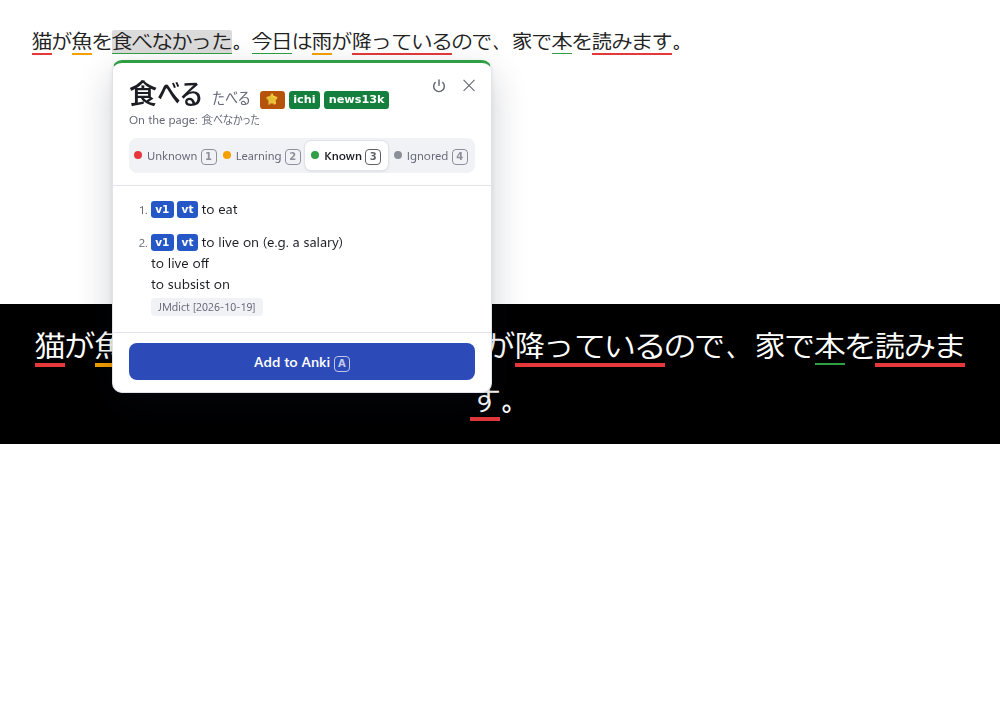

# Minerr

Minerr is a Chrome extension for Japanese sentence mining. It is a personal project. I made it for my own study, and I give no support or guarantee.

Sentence mining is a method to learn vocabulary from real content. You read or watch Japanese content. When you find an unknown word, you make a flashcard from the sentence that contains it. You then review the card in Anki.

Minerr does these steps in the browser:

1. It parses the Japanese text on each page into words, with the [kuromoji](https://github.com/takuyaa/kuromoji.js) tokenizer.
2. It underlines each word in the color of its status: unknown, learning, known, or ignored.
3. When you move the mouse over a word, it shows the dictionary definitions with their tags, for example `n` (noun) and `⭐` (high priority).
4. With one key, it makes an Anki card. The card has the word, the reading, the sentence, the definitions, and a screenshot of the tab.




## Features

- The extension parses the text on all pages, and also the text that appears later. Subtitles on YouTube and Netflix are page text, so Minerr parses them too.
- It joins a verb or adjective with its inflections into one word. For example, 食べなかった is one word with the dictionary form 食べる.
- It looks up definitions in a Yomitan dictionary that you import, for example JMdict.
- It shows the tags of the dictionary in color, as Yomitan does. The tags of the word, for example `⭐` (high priority) and `ichi` or `news13k` (frequent), are next to the reading. The tags of each definition, for example `v1` (Ichidan verb) and `uk` (usually in kana), are before the definition. Move the mouse over a tag to see what it means.
- If the word has more than one reading in the dictionaries, the popup shows each reading with its own definitions.
- It keeps the word statuses in the browser. A status change updates the underlines in all open tabs at once.
- It sends cards to Anki through AnkiConnect. It makes the deck and the note type if they do not exist.
- It can mark the words of your mature Anki cards as known.

All data stays on your computer. The extension sends requests only to AnkiConnect at `http://127.0.0.1:8765`.

## Install

### 1. Get the extension

```sh
git clone https://github.com/haziqhilmismail/minerr.git
```

The extension needs no build step. The kuromoji files are in `vendor/kuromoji`.

If you use WSL, Chrome on Windows must load the extension from a Windows folder. Copy the committed files to a Windows folder:

```sh
mkdir -p /mnt/c/Users/<you>/minerr
git -C minerr archive HEAD | tar -x -C /mnt/c/Users/<you>/minerr
```

### 2. Load the extension in Chrome

1. Open `chrome://extensions`.
2. Turn on **Developer mode**.
3. Click **Load unpacked**.
4. Select the `minerr` folder.

After you get a new version, click the reload button on the extension card.

Chrome gives an unpacked extension an ID from its folder path. If you load the extension from a different folder, it gets a new ID and starts with no data. Then you must import the dictionary again. To get your known words back, use **Import known words** (see below).

### 3. Install AnkiConnect

1. In Anki, click **Tools > Add-ons > Get Add-ons**.
2. Enter the code `2055492159`.
3. Restart Anki. AnkiConnect starts only when Anki starts.
4. Keep Anki open while you add cards.

AnkiConnect accepts requests from browser extensions by default. If the popup shows an error from AnkiConnect, open **Tools > Add-ons > AnkiConnect > Config**. Add `chrome-extension://<extension id>` to `webCorsOriginList`. The extension ID is on the `chrome://extensions` page.

### 4. Import a dictionary

1. Download [`JMdict_english.zip`](https://github.com/yomidevs/jmdict-yomitan/releases/latest/download/JMdict_english.zip) from the jmdict-yomitan project.
2. Open the options page. In `chrome://extensions`, click **Details** on Minerr, then click **Extension options**.
3. In **Dictionaries**, select the zip file, or drop it on the import area.
4. Wait for the message `Imported JMdict [...]: ... terms`. The import takes about one minute.

You can import other Yomitan term dictionaries in the same way. If you import a dictionary with the same title again, the new import replaces the old one.

Minerr shows the tags of all dictionaries. A dictionary that you imported with an earlier version of Minerr has no tags. Its row on the options page shows `Import again to show tags.` Import the zip file again to get the tags.

On the options page, click **Check connection** in the **Anki** section. The page must show `Connected (AnkiConnect version 6)`.


## Use

### Read and set statuses

Open a page with Japanese text. Each word gets an underline:

| Status | Underline | Meaning |
| --- | --- | --- |
| Unknown | Red | The default. You do not know the word yet. |
| Learning | Orange | You study the word now. |
| Known | Thin green | You know the word. |
| Ignored | None | You do not want to study the word, for example a name. |

Move the mouse over a word to open its popup. Then use these keys:

| Key | Action |
| --- | --- |
| `1` | Set the word to unknown. |
| `2` | Set the word to learning. |
| `3` | Set the word to known. |
| `4` | Set the word to ignored. |
| `A` | Add an Anki card. |
| `Esc` | Close the popup. |

The keys do not work when the focus is in a text field.

### Close the popup or turn Minerr off

- To close the popup, press `Esc`, click outside it, or click **✕** in its top-right corner.
- To turn Minerr off in all tabs, click the power button in the popup, or press `Alt+Shift+M`. The underlines and the popup stop at once.
- To turn Minerr on again, press `Alt+Shift+M`.

Use this when you want to compare Minerr with another dictionary extension, for example Yomitan. To change the shortcut, open `chrome://extensions/shortcuts`.

### Mine a sentence

1. Find an unknown word in a sentence.
2. Move the mouse over the word.
3. Press `A`.

Minerr hides the popup and makes a screenshot of the tab. Then it adds the card to Anki. If the word was unknown, its status changes to learning.

The sentence on the card is the sentence that contains the word. Minerr cuts it at `。`, `！`, `？`, and line breaks, and keeps closing quotes such as `」` with it. Minerr shows the word in bold in the sentence.

### Import known words from Anki

1. On the options page, go to **Known words**.
2. Enter an Anki search and the name of the field that holds the word.
3. Click **Import known words**.

Minerr sets each word from the matching cards to known. The default search is `deck:"Minerr" prop:ivl>=21`, which finds the cards with an interval of 21 days or more. The default field is `Word`.

## The note type

You do not make the note type yourself. When you add the first card, Minerr makes the deck and the note type in Anki through AnkiConnect. The default deck is `Minerr`. You can change the deck on the options page. Minerr adds the tag `minerr` to each note.

The note type is `Minerr`. It has these fields:

| Field | Content |
| --- | --- |
| `Word` | The dictionary form of the word, for example 食べる. |
| `Reading` | The reading from the dictionary, for example たべる. |
| `Sentence` | The sentence from the page. The word is in `<b>`. |
| `Definition` | The tags of the word, then the definitions as a numbered list with their tags and the dictionary name. It contains only the definitions for the reading in `Reading`. |
| `Image` | The screenshot of the tab. |

The note type has one card type, `Recognition`:

- **Front.** The sentence in large text, with the word in color. The dictionary form is in small text below it.
- **Back.** The front, then the word with its reading as furigana, the tags and the definitions, and the screenshot.

The card has a light theme and a night mode theme. It also fits phone screens. If a field is empty, the card does not show it.

| Front | Back |
| --- | --- |
|  |  |

Minerr keeps the note type up to date. Each time its background service worker starts, the first card that you add sets the templates and the CSS to the current version. If you change the templates or the CSS in Anki, Minerr replaces your changes. Minerr does not change the fields. If you want your own design, make a copy of the note type in Anki and edit the copy.

## Development

The code has no build step and no framework.

| Path | Purpose |
| --- | --- |
| `manifest.json` | The Manifest V3 declaration. |
| `background.js` | The service worker. It routes messages and calls AnkiConnect. |
| `offscreen.js` | Runs kuromoji and the dictionary lookups in an offscreen document. |
| `src/page.js` | Finds Japanese text on the page and wraps each word. |
| `src/popup.js` | The dictionary popup and its keys. |
| `src/status.js` | The word statuses, their colors, and their storage. |
| `src/tags.js` | The colors of the dictionary tags, for the popup and the card. |
| `src/anki.js` | The AnkiConnect client and the note type. |
| `src/db.js` | The dictionary storage in IndexedDB. |
| `src/group.js`, `src/sentence.js`, `src/yomitan.js`, `src/zip.js` | Pure functions for the parse, the sentence, the dictionary format, and the zip reader. |

To run the tests:

1. Run `npm install`.
2. Download `JMdict_english.zip` to `test/fixtures/JMdict_english.zip`.
3. Run `node test/unit.mjs`.
4. Close Anki, because the next test uses port 8765.
5. Run `node test/e2e.mjs`. It loads the extension in Chromium with Playwright and uses a mock AnkiConnect.

More scripts:

- `node test/screenshots.mjs` saves screenshots of the page, the popup, and the options page to `/tmp/minerr-ui`.
- `node test/card-preview.mjs` saves screenshots of the card to `/tmp/minerr-card`.
- If the system has no Japanese font, set `CJK_FONT_DIR` to a folder that contains one. Put an emoji font in the same folder, for example `seguiemj.ttf` from Windows. Without it, the `⭐` tag shows as a box.
- If Chromium cannot start because a library such as `libnss3.so` is missing, set `LD_LIBRARY_PATH` to a folder with the missing libraries.
- If you update kuromoji, run `npm run vendor` and commit the `vendor/kuromoji` folder.

## Third-party data

- `vendor/kuromoji` contains kuromoji.js and its dictionary, built from mecab-ipadic. The license and the notice are in that folder (Apache License 2.0 and the mecab-ipadic notice).
- Minerr does not include a dictionary for definitions. JMdict is the property of the [Electronic Dictionary Research and Development Group](https://www.edrdg.org/edrdg/licence.html) and has its own license.
