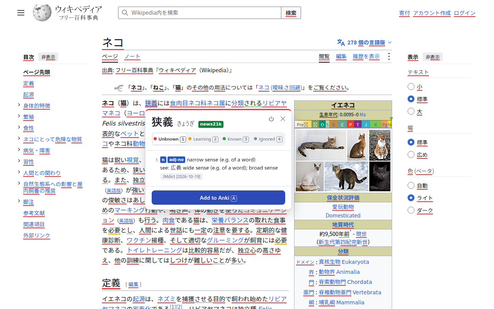
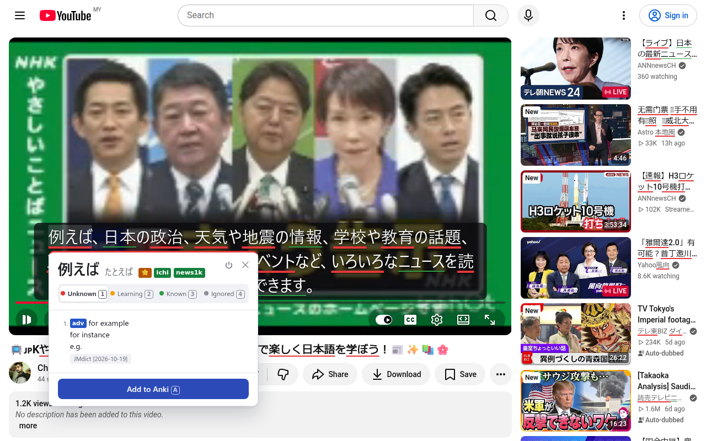
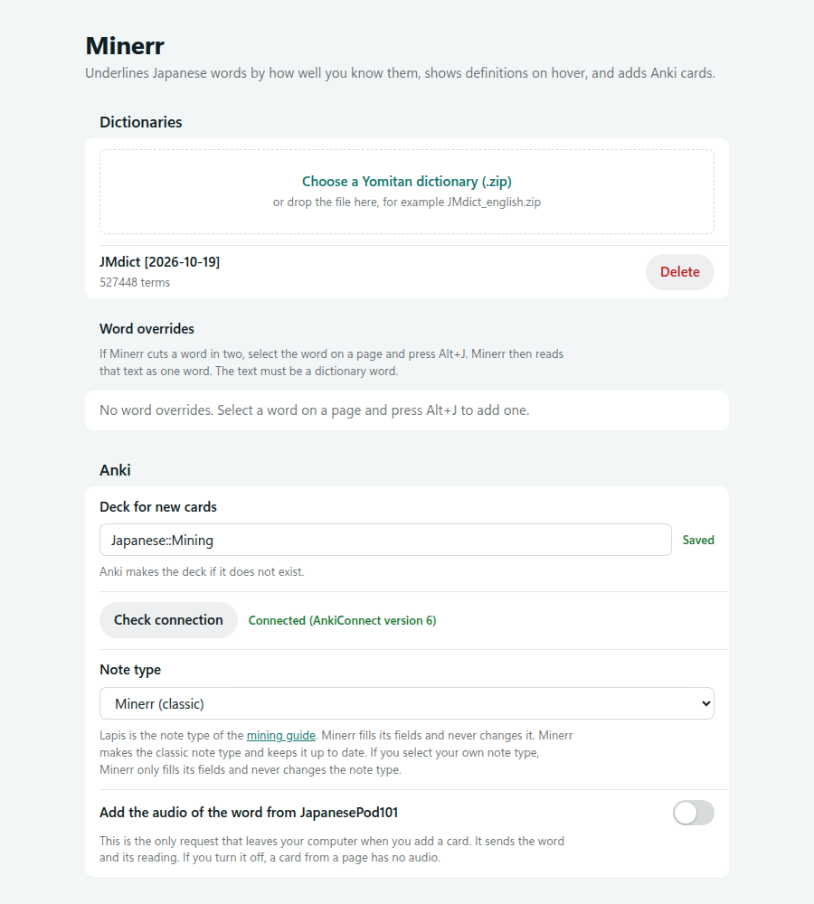
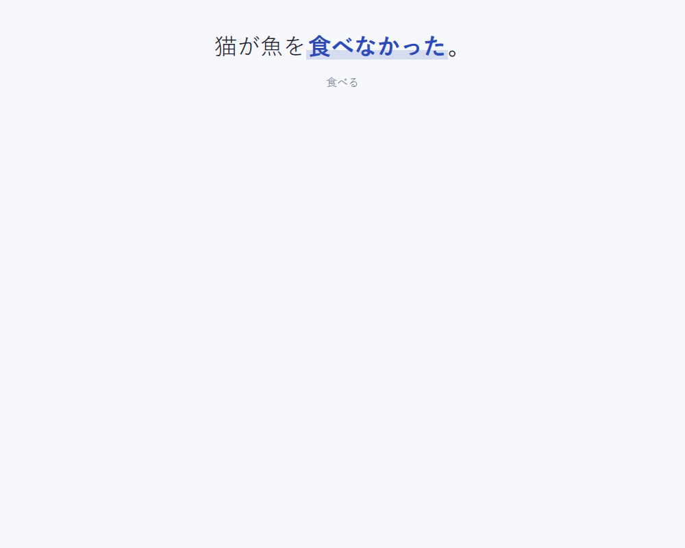
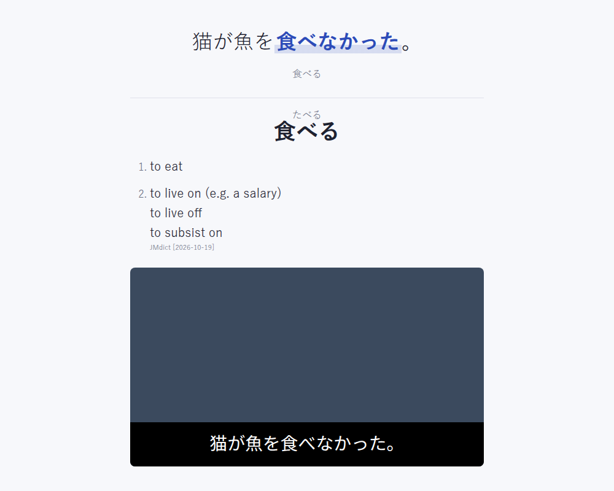

# Minerr

Minerr is a Chrome extension for Japanese sentence mining. It is a personal project. I made it for my own study, and I give no support or guarantee.

Sentence mining is a method to learn vocabulary from real content. You read or watch Japanese content. When you find an unknown word, you make a flashcard from the sentence that contains it. You then review the card in Anki.

Minerr does these steps in the browser:

1. It parses the Japanese text on each page into words, with the [kuromoji](https://github.com/takuyaa/kuromoji.js) tokenizer.
2. It underlines each word in the color of its status: unknown, learning, known, or ignored.
3. When you move the mouse over a word, it shows the dictionary definitions with their tags, for example `n` (noun) and `⭐` (high priority).
4. With one key, it makes an Anki card. The card has the word, the reading, the sentence, the definitions, and a screenshot of the tab.





The screenshots show the Japanese Wikipedia article [ネコ](https://ja.wikipedia.org/wiki/%E3%83%8D%E3%82%B3) (CC BY-SA 4.0) and an NHK やさしいことばニュース video on YouTube.

## Features

- The extension parses the text on all pages, and also the text that appears later. Subtitles on YouTube and Netflix are page text, so Minerr parses them too.
- It joins a verb or adjective with its inflections into one word. For example, 食べなかった is one word with the dictionary form 食べる.
- It joins nouns into the longest word that the dictionary has. For example, 食肉目ネコ科ネコ属 is three words: 食肉目, ネコ科, and ネコ属.
- All the spellings of one dictionary word share one status. For example, 猫, ねこ, and ネコ are one word.
- It reads text across inline markup as one text. For example, in `<ruby>暖<rt>あたた</rt></ruby>かくて`, 暖かくて is one word with the dictionary form 暖かい. Minerr does not parse the ruby text あたた, and it does not put it in the card sentence.
- It looks up definitions in a Yomitan dictionary that you import, for example JMdict.
- It shows the tags of the dictionary in color, as Yomitan does. The tags of the word, for example `⭐` (high priority) and `ichi` or `news13k` (frequent), are next to the reading. The tags of each definition, for example `v1` (Ichidan verb) and `uk` (usually in kana), are before the definition. Move the mouse over a tag to see what it means.
- If the word has more than one reading in the dictionaries, the popup shows each reading with its own definitions.
- It keeps the word statuses in the browser. A status change updates the underlines in all open tabs at once.
- It sends cards to Anki through AnkiConnect. It makes the deck and the note type if they do not exist.
- It can mark the words of your mature Anki cards as known.
- On YouTube, it shows the subtitles in its own large overlay at the bottom center of the video. You can look up and mine the words in the overlay. The overlay also works on other video sites and on video files from your computer.
- A card from a subtitle line gets the audio of the line.
- It can make Japanese subtitles for a YouTube video with WhisperX, in a small server on your computer.
- It shows a comprehension score for each page or video, and the recommended i+1 sentences.
- It has a word browser to find, sort, and change word statuses, and to add a list of known words.
- It has a reader for `.epub`, `.txt`, `.srt`, and `.vtt` files, with vertical text, and a page for pasted text.

All data stays on your computer. The extension sends requests only to AnkiConnect at `http://127.0.0.1:8765` and to the optional WhisperX server at `http://127.0.0.1:8766`.

## Install

### 1. Build the extension

You need [Node.js](https://nodejs.org/) 24 or later.

```sh
git clone https://github.com/haziqhilmismail/minerr.git
cd minerr
npm ci
npm run build
```

The build compiles the TypeScript code and writes the extension to the `dist` folder.

If you use WSL, Chrome on Windows must load the extension from a Windows folder. Build the extension, then copy the `dist` folder to a Windows folder:

```sh
npm run build && mkdir -p /mnt/c/Users/<you>/minerr && cp -r dist/. /mnt/c/Users/<you>/minerr/
```

### 2. Load the extension in Chrome

1. Open `chrome://extensions`.
2. Turn on **Developer mode**.
3. Click **Load unpacked**.
4. Select the `minerr/dist` folder. If you use WSL, select the Windows folder.

After you get a new version, run `npm run build` again. If you use WSL, copy the `dist` folder again with the command above. Then click the reload button on the extension card.

Chrome gives an unpacked extension an ID from its folder path. If you load the extension from a different folder, it gets a new ID and starts with no data. Then you must import the dictionary again. To get your known words back, use **Import known words** (see below).

### 3. Install AnkiConnect

1. In Anki, click **Tools > Add-ons > Get Add-ons**.
2. Enter the code `2055492159`.
3. Restart Anki. AnkiConnect starts only when Anki starts.
4. Keep Anki open while you add cards.

AnkiConnect accepts requests from browser extensions by default. If the popup shows an error from AnkiConnect, open **Tools > Add-ons > AnkiConnect > Config**. Add `chrome-extension://<extension id>` to `webCorsOriginList`. The extension ID is on the `chrome://extensions` page.

### 4. Import a dictionary

1. Download [`JMdict_english.zip`](https://github.com/yomidevs/jmdict-yomitan/releases/latest/download/JMdict_english.zip) from the jmdict-yomitan project.
2. Open the options page. In `chrome://extensions`, click **Details** on Minerr, then click **Extension options**.
3. In **Dictionaries**, select the zip file, or drop it on the import area.
4. Wait for the message `Imported JMdict [...]: ... terms`. The import takes about one minute.

You can import other Yomitan term dictionaries in the same way. If you import a dictionary with the same title again, the new import replaces the old one.

If you imported JMdict with an earlier version of Minerr, import it again. The new import keeps the entry number of each word, so the spellings of a word can share a status. See [Spellings of one word](#spellings-of-one-word).

Minerr shows the tags of all dictionaries. A dictionary that you imported with an earlier version of Minerr has no tags. Its row on the options page shows `Import again to show tags.` Import the zip file again to get the tags.

On the options page, click **Check connection** in the **Anki** section. The page must show `Connected (AnkiConnect version 6)`.



## Use

### Read and set statuses

Open a page with Japanese text. Each word gets an underline:

| Status | Underline | Meaning |
| --- | --- | --- |
| Unknown | Red | The default. You do not know the word yet. |
| Learning | Orange | You study the word now. |
| Known | Thin green | You know the word. |
| Ignored | None | You do not want to study the word, for example a name. |

Move the mouse onto a word and stop it there. The popup of the word opens after 0.3 seconds. To open the popup at once, hold `Shift` while the mouse is on a word. To change when the popup opens, see [Word popup](#word-popup). The popup does not open while text is selected or a mouse button is down.

When the popup is open, use these keys:

| Key | Action |
| --- | --- |
| `1` | Set the word to unknown. |
| `2` | Set the word to learning. |
| `3` | Set the word to known. |
| `4` | Set the word to ignored. |
| `A` | Add an Anki card. |
| `Esc` | Close the popup. |

The keys do not work when the focus is in a text field.

### Spellings of one word

A status belongs to a word, not to a spelling. A word is one JMdict entry. For example, the entry 猫 has the spellings 猫 and ネコ and the reading ねこ. When you set 猫 to known, ねこ and ネコ also become known.

Minerr finds the entry from the dictionary form and the reading of the word on the page:

- If one entry fits, all the spellings of that entry share one status.
- If more than one entry fits, the spelling keeps its own status. For example, かみ can be 紙, 神, or 髪.
- If one spelling has two readings in two entries, each entry has its own status. For example, 上手 (じょうず) and 上手 (うわて) are two words.
- If you have no dictionary that has entry numbers, each spelling has its own status.

The status key is the text that Minerr stores for the word. The key is the headword of the entry, for example 猫. If a more common entry has the same headword, the key also has the reading of the entry, for example `上手【うわて】`. The status file and the word browser show these keys.

The popup shows the headword and the reading of the entry. If the spelling on the page is different, the popup also shows it, for example `On the page: ネコ`.

Earlier versions of Minerr stored the status under the spelling of the dictionary form, for example ねこ. Minerr still reads such a status if the new key has no status. When you change the status of the word, Minerr writes the new key and removes the old one.

### Mark words in bulk

1. Select text on the page with the mouse.
2. Press a status key, `1` to `4`.

Minerr sets each word that the selection touches to that status. A short message at the bottom of the page shows the number of words, for example `Marked 5 words as known.` The selection wins over an open popup.

### Close the popup or turn Minerr off

- To close the popup, press `Esc`, click outside it, or click **✕** in its top-right corner.
- To turn Minerr off in all tabs, click the power button in the popup, or press `Alt+Shift+M`. The underlines and the popup stop at once.
- To turn Minerr on again, press `Alt+Shift+M`, or click the Minerr button in the Chrome toolbar and turn on **Minerr on**.

To turn Minerr off for one site only:

- Press `Alt+Shift+D` on a page of the site. A short message at the bottom of the page confirms the change.
- Or click the Minerr button in the Chrome toolbar, then click the **Minerr on this site** switch.

Minerr stays off on all pages of that site, also after a restart of Chrome. To turn it on again, press `Alt+Shift+D` again or click the switch again. The other sites do not change.

When Minerr is off, YouTube shows its own captions again, and the Minerr subtitle overlay is hidden.

Use this when you want to compare Minerr with another dictionary extension, for example Yomitan. To change the shortcut, open `chrome://extensions/shortcuts`.

### Mine a sentence

1. Find an unknown word in a sentence.
2. Move the mouse over the word.
3. Press `A`.

Minerr hides the popup and makes a screenshot of the tab. Then it adds the card to Anki. If the word was unknown, its status changes to learning.

The sentence on the card is the sentence that contains the word. Minerr cuts it at `。`, `！`, `？`, and line breaks, and keeps closing quotes such as `」` with it. Minerr shows the word in bold in the sentence.

### Import known words from Anki

1. On the options page, go to **Known words**.
2. Enter an Anki search and the name of the field that holds the word.
3. Click **Import known words**.

Minerr sets each word from the matching cards to known. If a dictionary has the word, Minerr uses the status key of its entry, so 猫科 becomes ネコ科. The default search is `deck:"Minerr" prop:ivl>=21`, which finds the cards with an interval of 21 days or more. The default field is `Word`.

## Find i+1 sentences

An i+1 sentence has exactly one unknown word. You know all the other words in it, so it makes a good card. Minerr gives each i+1 sentence a soft yellow background.

- Minerr counts only the words with a red underline. Learning, known, and ignored words do not count.
- A sentence must have two words or more. A single word, for example a link or a menu item, gets no highlight.
- Minerr cuts the sentences with the same rule as the card sentence: at `。`, `！`, `？`, and line breaks.
- The highlight also shows in the subtitle overlay on YouTube and in the video player.
- When a word status changes, the highlight changes in all open tabs.

The highlight does not change the page. Minerr uses the CSS Custom Highlight API.

To turn the highlight off or on:

1. Click the Minerr button in the Chrome toolbar.
2. Click the **Highlight i+1 sentences** switch.

When you turn Minerr off, the highlight also goes away.

## Comprehension score

The toolbar menu shows how much of the current tab you understand.

1. Open a page with Japanese text, or a YouTube video.
2. Click the Minerr button in the Chrome toolbar.

The **Comprehension** section shows these items:

- The score: the percent of the words with the status known or ignored. A learning word does not count as understood.
- A label for the score, as in Migaku. The table below gives the labels.
- The number of different words with each status.
- The recommended sentences: the i+1 sentences of the tab, each one time. Click a sentence to scroll the tab to it. The sentence gets a yellow flash.

| Score | Label |
| --- | --- |
| 99% or more | Exceptional |
| 95% to 98% | Excellent |
| 90% to 94% | Great |
| 80% to 89% | Good |
| 70% to 79% | Approachable |
| 60% to 69% | Challenging |
| Less than 60% | Ambitious |

On a YouTube video, the score uses only the subtitle lines that the overlay showed in the tab. The score changes while you watch. When you open a different video, the count starts again. You cannot click a subtitle sentence, because the line is not on the page now.

Migaku also uses the number of i+1 sentences in its score. Minerr uses only the percent of the words.

## Subtitles on YouTube

On a YouTube video page, Minerr shows the subtitles in its own overlay, in large white text on a dark box. The overlay is at the bottom center of the video, above the player controls. The text size changes with the player size, also in theater mode and full screen. Minerr hides the captions of YouTube, because the overlay shows the same text.

To see YouTube captions in the overlay:

1. Open a video that has Japanese captions.
2. Turn on captions in the YouTube player. Click **CC** or press `C`.
3. If the video has more than one caption track, select the Japanese track in **Settings > Subtitles/CC**.

If the captions are off, the overlay shows nothing. When a caption has two lines, the overlay shows two lines.

The overlay text is page text. Minerr underlines its words, and the popup and the keys work on it. Pause the video, then move the mouse over a word. If you press `A`, the `Sentence` field gets the overlay line that contains the word.

You can also use the keyboard on the subtitle line:

- Press `N` to open the popup of the first unknown word of the line. Press `N` again to go to the next unknown word. After the last unknown word, `N` goes back to the first one.
- If the line has exactly one unknown word, press a status key, `1` to `4`, to set that word. You do not need to open the popup. A short message shows the change.

These keys work in the Minerr video player too. If the line has no unknown word, the page gets the key, so YouTube keys still work.

### YouTube subtitles with times

The captions that Minerr copies from the YouTube player have no times. Thus the keys that go to a line, the play modes, and the sentence audio do not work with them. If the Minerr server runs, Minerr gets the Japanese subtitles of the video with times:

1. Start the server, as [Generate subtitles with WhisperX](#generate-subtitles-with-whisperx) shows.
2. Open a YouTube video.
3. Wait some seconds. The server downloads the subtitles with `yt-dlp`.

The server uses the subtitles of the uploader first. If the video has none, it uses the automatic subtitles of YouTube. The overlay then shows the subtitles at the times of the video, also when the YouTube captions are off. If the video has no Japanese subtitles, the overlay copies the YouTube captions as before.

The server keeps the subtitles in `~/.cache/minerr/subs/<video id>.captions.ja.json`. The file of a video with no Japanese subtitles contains `{}`. After one day, the server asks YouTube again, because YouTube can add automatic subtitles some hours after the upload. To download the subtitles again at once, delete the file.

## Generate subtitles with WhisperX

Some videos have no Japanese captions, or captions of low quality. For these videos, Minerr can make subtitles from the audio with [WhisperX](https://github.com/m-bain/whisperX). WhisperX runs in a small server on your computer.

### Requirements

- Linux, or WSL on Windows.
- [uv](https://docs.astral.sh/uv/). uv installs Python 3.12, WhisperX, and PyTorch for the server.
- `yt-dlp` and `ffmpeg` in your `PATH`. `yt-dlp` uses Node.js for the YouTube JavaScript challenges.
- About 4 GB of free memory and 5 GB of free disk space. The server uses about 3.5 GB of memory with the default model.

The server uses the CPU. It does not need a GPU, so it also works on a computer with an AMD GPU or with no CUDA.

### Start the server

```sh
uv run server/whisper_server.py
```

The first start installs about 2.6 GB of packages. The first job also downloads the model, about 1.6 GB. Keep the terminal open while you use the server.

If you use WSL, start the server in WSL. Chrome on Windows connects to it at `http://127.0.0.1:8766`, because WSL forwards localhost ports to Windows.

The default model is `large-v3-turbo`. To use a different model, add `--model`, for example `--model small`. The `small` model is about 2.5 times faster, but it makes more mistakes in Japanese. For example, it wrote 自身 for 地震, 部身 for 文, and 感じに振り金 for 漢字にふりがな.

The server uses one thread per CPU core. To change this, add `--threads`.

### Make subtitles for a video

1. Open the YouTube video.
2. Click the Minerr button in the Chrome toolbar. If you do not see it, click the extensions button and pin Minerr.
3. Click **Generate with WhisperX**.
4. Wait until the popup shows `The WhisperX subtitles are ready.`

You can close the popup while the server works. The tab gets the subtitles when the job is done. Then the overlay shows the WhisperX subtitles at the time of the video.

To go back to the YouTube captions, open the popup and click **YouTube captions**. To show the WhisperX subtitles again, click **WhisperX**.

### Speed

On a Ryzen 5 7600X (6 cores), the server needs about 24 seconds for 100 seconds of audio with `large-v3-turbo`. This is about 4 times faster than the video. A 20-minute video takes about 5 minutes. The `small` model needs about 10 seconds for the same audio.

### Cache and privacy

The server keeps the subtitles in `~/.cache/minerr/subs/<video id>.<model>.json`. When you open a video again, Minerr shows these subtitles at once. To make the subtitles again, delete the file.

The server also keeps the audio of each video in `~/.cache/minerr/audio/`, for the sentence audio of the cards. A 20-minute video needs about 20 MB. To free the disk space, delete the files in this folder.

The audio stays on your computer. Only `yt-dlp` connects to YouTube, to download the audio. WhisperX downloads its models from Hugging Face the first time. The server accepts connections only from your computer.

## Mine a local video

You can mine a video file from your computer. The Minerr video player shows the subtitles in the same large overlay as on YouTube.

1. Click the Minerr button in the Chrome toolbar.
2. Click **Play a local video**. The player opens in a new tab.
3. Drop a video file on the page, or click **Choose a video**.
4. To use a subtitle file, drop it together with the video, or click **Add subtitle file**. Minerr reads `.srt` and `.vtt` files. To show a second subtitle file under the line, for example in English, click **Add second subtitle file**.
5. Pause the video, then move the mouse over a word in the subtitles.
6. Press `A` to add an Anki card.

The `Sentence` field gets the subtitle line that contains the word. The `Image` field gets a screenshot of the player tab.

Chrome plays MP4 and WebM files. If Chrome cannot play the file, the player shows an error. Then convert the file to MP4 or WebM, for example with `ffmpeg -i video.mkv video.mp4`.

To show the video in full screen, click **Full screen**. Do not use the full screen of the video controls, because it shows the video without the subtitles. The player removes that button.

### Make subtitles with WhisperX

If you have no subtitle file, the WhisperX server can make the subtitles. Start the server first, as [Generate subtitles with WhisperX](#generate-subtitles-with-whisperx) shows.

1. Open the video in the player.
2. Click **Generate with WhisperX**.
3. Wait until the player shows `WhisperX subtitles: <number> lines.`

The player sends the video file to the server on your computer. The file does not go to the internet. The server takes out the audio with ffmpeg and transcribes it. The server deletes its copy of the file when the job ends.

Keep the player tab open while the server works. If you close the tab, open the video again and click **Generate with WhisperX** again. The server keeps the subtitles in `~/.cache/minerr/subs/<SHA-256 of the file>.<model>.json`. Thus it does not transcribe the same file two times.

### Save the subtitles

Click **Save subtitles** to download the WhisperX subtitles as an `.srt` file. The file gets the name of the video, for example `lesson.srt` for `lesson.mp4`. Keep the `.srt` file in the same folder as the video. Next time, open the video and the `.srt` file together. Then you do not need the server. Most video players also show an `.srt` file that has the name of the video.

## Subtitles on other video sites

Minerr can show its subtitle overlay on the video of a page that is not YouTube.

1. Open the page with the video.
2. Click the Minerr button in the Chrome toolbar.
3. Click **Subtitles for the video of this page**. Minerr puts its overlay on the largest video on the screen.
4. Click a button at the top left of the video:
   - **Subtitle file** reads an `.srt` or `.vtt` file from your computer.
   - **Subtitles of the site** asks the Minerr server for the Japanese subtitles of the page. The server uses `yt-dlp`, which knows many video sites.
   - **WhisperX** makes the subtitles from the audio of the page. The server downloads the audio with `yt-dlp`.
5. To remove the buttons, click **Hide these buttons**. The overlay stays until you reload the page.

The keys, the play modes, the subtitle browser, and the sentence audio work as on YouTube.

Limits:

- `yt-dlp` cannot download from a site with DRM, for example Netflix. The overlay then shows the error of the server. Use a subtitle file, if you have one. The sentence audio then comes from a recording in the tab, if the site allows it.
- The video must be in the page itself. Some sites play the video in a frame, and Minerr does not see a video in a frame.
- Minerr does not copy the captions of Netflix or other sites. On YouTube only, it copies the captions of the player.

## Sentence audio

When you add a card for a word in the subtitle overlay, the card also gets the audio of the subtitle line. The audio starts 0.5 seconds before the line and stops 0.5 seconds after it. To change this time, open the options page and change **Sentence audio padding** in **Video**.

The audio comes from one of these sources:

1. The Minerr server cuts the line from its copy of the audio, as an MP3 file. This works for a YouTube video, and for a file that you sent to the server with **Generate with WhisperX**. The first card of a video starts the download of its audio. The later cards of the video get the MP3 file.
2. If the server is off or has no audio of the video, Minerr records the line in the tab. The video goes back to the start of the line and plays it again. Then the video goes back to where it was. The recording is a WebM file.

The sentence audio needs subtitles with times. A card from the YouTube captions that Minerr copies from the player has no sentence audio.

Anki on a computer plays MP3 and WebM files. If a phone app does not play a WebM file, start the server before you add the card. Then the card gets an MP3 file.

## Play modes

A play mode pauses the video on its own. Open the options page, go to **Video**, and select a **Play mode**:

| Play mode | The video pauses |
| --- | --- |
| **Normal** | Never. This is the default. |
| **Pause before each line** | At the start of each line. Read the line, then play the video to hear it. |
| **Pause after each line** | At the end of each line. The line stays on the screen. |
| **Pause after i+1 lines** | At the end of each line with exactly one unknown word. |

The play modes need subtitles with times. Press `↓` or `S` to hear the line again. Press `→` or `D` to go to the next line.

More settings in **Video**:

- **Play again after a pause of the play mode.** The video plays again after 3, 6, or 10 seconds. It does not play while the mouse is on the line or a word popup is open.
- **Open the first unknown word after a pause of the play mode.** The popup of the first unknown word of the line opens.
- **Pause while the mouse is on the subtitles.** The video pauses when the mouse moves onto the subtitle line. It also stays paused while the popup of a subtitle word is open. The video plays again when the mouse goes away and the popup closes. This setting is on by default.

## Subtitle browser

The subtitle browser is a list of all lines of the video, at the right side of the video. It needs subtitles with times.

1. Press `G` on the video. The list opens.
2. Click a line, or its time, to go to that line.
3. Move the mouse over a word in the list to open its popup. A card from a word in the list gets the sentence and the audio of that line.
4. Press `G` again to close the list.

Click a filter at the top of the list:

| Filter | The list shows |
| --- | --- |
| **All** | All lines. |
| **1 unknown word** | The lines with exactly one unknown word, as the i+1 highlight counts them. |
| **Learning** | The lines with a word that has the status learning. |
| **Bookmarks** | The lines that you bookmarked. |

To bookmark the current line, press `B`, or click **★** in the list. Press `B` again to remove the bookmark. Minerr keeps the bookmarks of each video. The bookmarks of a YouTube video belong to its video ID, and the bookmarks of a file belong to its name and size.

## Subtitle display

Open the options page and go to **Video** to change these settings. They apply to the subtitle overlay on all video pages.

- **Obscure the subtitles.** The overlay blurs or hides the text while the video plays. The text shows when you move the mouse onto it or pause the video. Select **Blur** or **Hide**. Press `W` on a video to turn this on or off.
- **Second subtitles.** A second subtitle track, for example English, shows under the Japanese line. Select **Show**, **On hover or pause**, or **Off**. Press `Shift+W` on a video to show or hide it. On YouTube, the server gets the English subtitles of the video, as it does for the Japanese subtitles. In the video player, click **Add second subtitle file**.
- **Remove bracketed text.** Minerr removes text in brackets, for example （笑）, (laughs), [音楽], and 【拍手】. A line with only bracketed text does not show.
- **Parts with no subtitles.** For a part of 1.5 seconds or more with no line, the video plays at 2× or 4× speed, or skips the part. The last 0.5 seconds before the next line play at the normal speed. This needs subtitles with times.

## Video keys

These keys work on a video with the Minerr subtitle overlay: on YouTube, in the video player, and on other sites. They do not work when the focus is in a text field.

| Key | Action | Note |
| --- | --- | --- |
| `→` or `D` | Go to the next line. | Needs subtitles with times. |
| `←` | Go to the previous line. | Needs subtitles with times. |
| `↓` or `S` | Play the current line again. | Needs subtitles with times. |
| `Alt+A` | Go back 5 seconds. | |
| `Alt+D` | Go forward 5 seconds. | |
| `C` | Copy the current line. | |
| `J` | Join the next line to the current line. A card then gets both lines as the sentence, and the audio of both. Press `J` again to stop. | Needs subtitles with times. |
| `G` | Open or close the subtitle browser. | Needs subtitles with times. |
| `B` | Bookmark the current line, or remove its bookmark. | Needs subtitles with times. |
| `.` | Go one frame forward. The video pauses. | Needs subtitles with times. |
| `,` | Go one frame back. The video pauses. | Needs subtitles with times. |
| `Alt+O` | Show the subtitles 0.1 seconds later. | Needs subtitles with times. |
| `Alt+I` | Show the subtitles 0.1 seconds earlier. | Needs subtitles with times. |
| `Alt+=` | Make the subtitles larger. | |
| `Alt+-` | Make the subtitles smaller. | |
| `Shift+W` | Show or hide the second subtitle track. | Needs subtitles with times. |
| `W` | Blur or hide the subtitles until you move the mouse onto them or pause, or show them again. | |

Subtitles with times come from WhisperX, from a subtitle file, or from the YouTube subtitles that the Minerr server downloads. The YouTube captions that Minerr copies from the player have no times. With these captions, a key that needs times shows a hint, and YouTube gets the key.

YouTube also uses some of these keys, for example `C`, `J`, `.`, `,`, and the arrow keys. While the overlay shows subtitles, the Minerr action replaces the YouTube action. `C` copies a line only when the overlay shows one. Otherwise YouTube gets `C` and turns the captions on or off.

`A` is not a video key, because `A` adds a card in the word popup.

The offset applies to the open video until you open a different video. The text size applies to all videos, and Minerr keeps it.

The options page also shows these keys, in **Colors and shortcuts**.

## Read a file

The Minerr reader shows the text of a book or a subtitle file. The words get underlines, and the popup, the keys, and the i+1 highlight work as on a web page.

1. Click the Minerr button in the Chrome toolbar.
2. Click **Read a file**. The reader opens in a new tab.
3. Drop a file on the page, or click **Choose a file**.

The reader reads these files:

| File | Content |
| --- | --- |
| `.epub` | Each chapter of the book. The **Chapter** list shows the first heading of each chapter. |
| `.txt` | Each line with text is a paragraph. A long file is cut into parts of about 10,000 characters. |
| `.srt`, `.vtt` | Each subtitle is a paragraph. The reader does not show the times. |

The reader keeps only the text of an EPUB file. It keeps the paragraphs, the headings, and the furigana (ruby). It removes the scripts, the styles, the links, and the images. The furigana is not page text, so a card sentence does not contain it.

Use these keys to turn the pages:

| Key | Action |
| --- | --- |
| `PageDown`, `Space`, `↓` | Go to the next page. At the end of a chapter, open the next chapter. |
| `PageUp`, `Shift+Space`, `↑` | Go to the previous page. At the start of a chapter, open the end of the chapter before. |
| `→` | Go to the next page. In vertical text, go to the previous page. |
| `←` | Go to the previous page. In vertical text, go to the next page. |

The keys do not work when the focus is in a text field or a list.

To show vertical text, click **Vertical text**. The lines go from top to bottom, and from right to left. The mouse wheel also turns the lines. Click **Vertical text** again to show horizontal text. Minerr keeps this setting for all files.

Minerr keeps the place where you stop in each file. When you open the same file again, the reader shows the same chapter and the same place. Minerr knows a file by its name and its size.

## Paste text

You can read text that you copy, for example from a game or a different program.

1. Click the Minerr button in the Chrome toolbar.
2. Click **Paste text**.
3. Copy Japanese text, then press `Ctrl+V` on the page.

Each paste adds the text at the bottom of the page. To remove all the texts, click **Clear**.

### Auto-paste

With **Auto-paste**, the page adds the text from the clipboard each time the page gets the focus. You do not press `Ctrl+V`.

1. Select **Auto-paste**.
2. Chrome asks for the permission to read the clipboard. Click **Allow**.
3. Copy text in a different program, then click the Minerr page.

If the clipboard has the same text as the last paste, the page adds nothing. Minerr asks for the clipboard permission only when you select **Auto-paste**, so the installation of Minerr asks for no clipboard permission.

## The note type

You do not make the note type yourself. When you add the first card, Minerr makes the deck and the note type in Anki through AnkiConnect. The default deck is `Minerr`. You can change the deck on the options page. Minerr adds the tag `minerr` to each note.

The note type is `Minerr`. It has these fields:

| Field | Content |
| --- | --- |
| `Word` | The dictionary form of the word, for example 食べる. |
| `Reading` | The reading from the dictionary, for example たべる. |
| `Sentence` | The sentence from the page. The word is in `<b>`. |
| `Definition` | The tags of the word, then the definitions as a numbered list with their tags and the dictionary name. It contains only the definitions for the reading in `Reading`. |
| `Image` | The screenshot of the tab. |
| `SentenceAudio` | The audio of the subtitle line, for a word in video subtitles. See [Sentence audio](#sentence-audio). |

The note type has one card type, `Recognition`:

- **Front.** The sentence in large text, with the word in color. The dictionary form is in small text below it.
- **Back.** The front, then the word with its reading as furigana, the tags and the definitions, and the screenshot.

The card has a light theme and a night mode theme. It also fits phone screens. If a field is empty, the card does not show it.

| Front | Back |
| --- | --- |
|  |  |

Minerr keeps the note type up to date. Each time its background service worker starts, the first card that you add sets the templates and the CSS to the current version. If you change the templates or the CSS in Anki, Minerr replaces your changes. If the note type does not have a field of the current version, Minerr adds the field. For example, a note type from an earlier version gets the `SentenceAudio` field. Minerr does not remove or rename a field. If you want your own design, make a copy of the note type in Anki and edit the copy.

If an Anki window to add, browse, or edit cards is open, AnkiConnect cannot change the note type. Then the popup tells you to close the window.

## Use your own note type

You can add cards to a note type that you made in Anki, as with the field templates of Yomitan.

1. Open Anki.
2. Open the options page.
3. In **Anki**, click **Check connection**. Minerr gets the list of your note types.
4. In **Note type**, select your note type. Minerr shows one text field for each field of the note type.
5. In each text field, write the content of the field with markers. Minerr saves each change at once.

Minerr replaces each marker when it adds a card:

| Marker | Content |
| --- | --- |
| `{word}` | The dictionary form of the word, for example 食べる. |
| `{reading}` | The reading from the dictionary, for example たべる. |
| `{furigana}` | The word with its reading in the furigana syntax of Anki, for example `食べる[たべる]`. Use it with `{{furigana:Field}}` in the card template. |
| `{sentence}` | The sentence from the page. The word is in `<b>`. |
| `{definition}` | The tags and the definitions, as in the `Definition` field of the built-in note type. |
| `{image}` | The screenshot of the tab, as ``. Minerr stores the file in the media folder of Anki. |
| `{audio}` | The audio of the subtitle line, as `[sound:...]`. It is empty for a word that is not in video subtitles. |
| `{url}` | The address of the page. |
| `{title}` | The title of the page. |

The text around the markers stays as you write it. It can contain HTML, for example `<a href="{url}">{title}</a>`. You can put more than one marker in a field. You can leave a field empty.

If a field contains an unknown marker, for example `{Word}`, the options page shows an error and does not save the change. The markers are in lower case.

When you select a note type, Minerr suggests a marker for each field from the name of the field. For example, a field with the name `Expression` gets `{word}`, and a field with the name `Picture` gets `{image}`. Examine the suggestions, and change them if necessary.

The **Preview** shows the fields of a card for 食べる, as Anki shows them.

With your own note type, Minerr does not make or change a note type. If you add, remove, or rename a field in Anki, open the options page again or click **Check connection**. Minerr then updates the list of fields. A new field gets a suggested marker.

The **Word field** in **Known words** changes to the field that contains `{word}`.

To use the Minerr note type again, select **Minerr (built-in)**.

## Back up word statuses

Minerr keeps the word statuses in the browser. If you remove the extension or load it from a different folder, the statuses are lost. Export them to a file to keep a copy.

The **Word statuses** section of the options page shows the number of words with each status.

To export the statuses:

1. Open the options page.
2. In **Word statuses**, click **Export statuses**.

Chrome downloads the file `minerr-statuses-YYYY-MM-DD.json`. The file contains all words with the status learning, known, or ignored. Unknown words are not in the file.

To import the statuses:

1. Open the options page.
2. In **Word statuses**, click **Import statuses**.
3. Select a file that you exported.

The import keeps the words that are not in the file. If a word is in the file, the status from the file replaces the current status. Minerr changes each word of the file to the status key of its entry, so ねこ becomes 猫. The page shows the number of words that the import added, changed, and did not change. The new statuses apply at once in all open tabs.

If the file is not a correct Minerr status file, the page shows the problem, and Minerr changes no status.

The file is JSON:

```json
{
  "format": "minerr-statuses",
  "version": 1,
  "exported": "2026-10-20T04:19:56.137Z",
  "words": { "猫": "known", "魚": "learning", "田中": "ignored" }
}
```

## Word popup

You can choose when the word popup opens.

1. Open the options page.
2. In **Word popup**, click **Hover**, **Hover on unknown words**, or **Shift + hover**.

| Mode | The popup opens when |
| --- | --- |
| **Hover** | The mouse stops on a word for 0.3 seconds. This is the default. |
| **Hover on unknown words** | The mouse stops on an unknown word for 0.3 seconds. For other words, hold `Shift`. |
| **Shift + hover** | You hold `Shift` and the mouse is on a word. |

In all modes, `Shift` opens the popup at once. You can press `Shift` before or after you move the mouse onto the word. If a popup is open, the popup of the next word opens after 0.05 seconds. A quick pass of the mouse over a word does not open a popup. The change applies at once in all tabs.

### Look up selected text

Select text on the page, then press `Alt+S`. Minerr looks up the longest dictionary word at the start of the selection, also in its dictionary form. For example, if you select 食べなかった, the popup shows 食べる. Use this for a word that Minerr cuts in a different way, or for a word in text that Minerr does not underline. If no dictionary has a word at the start of the selection, a short message tells you.

`A` in this popup adds a card with the sentence around the selected word.

### Popups in a popup

Japanese text in the definitions of a popup is also cut into words. Hold `Shift` and move the mouse onto such a word: a new popup opens over the first one. You can open up to 4 popups in this way. A plain hover in a popup opens nothing, so you can move the mouse over the definitions.

- `Esc` closes the top popup only.
- A click in a popup closes the popups over it.
- The status keys and `A` act on the word of the top popup.

### Sentence highlight

When you move the mouse onto a word, Minerr gives the sentence of the word a light blue background. While the popup is open, the sentence of its word keeps the background. Minerr cuts the sentence with the same rule as the card sentence.

To turn the sentence highlight off or on, press `Alt+Shift+S` on a page. Or, on the options page, use **Highlight the sentence of the word under the mouse** in **Word popup**. The highlight is on by default.

### Count on the page

Under the word, the popup shows how many times the word appears on the page, for example `Appears 4 times on this page`. Minerr counts the words with the same status key, so 食べた and 食べなかった both count for 食べる, and ねこ and ネコ both count for 猫.

## Furigana

Minerr can show the reading of a word in hiragana over the word. It shows readings only over words with kanji.

1. Open the options page.
2. In **Furigana**, click **Off**, **Unknown words**, **All words**, or **On hover**.

| Mode | The reading shows |
| --- | --- |
| **Off** | Nowhere. This is the default. |
| **Unknown words** | Over each word with a red underline. When the status of a word changes, its reading goes away. |
| **All words** | Over each word with kanji. |
| **On hover** | Over the word under the mouse, and over the word of the open popup. |

The reading comes from the kuromoji tokenizer, so it is the reading of the word on the page, for example たべなかった for 食べなかった. Minerr makes a line taller when a word in it gets a reading, so the reading does not cover the line above. The reading is not page text: when you copy text or add a card, the text has no readings.

## Frequency and pitch accent

Minerr also reads Yomitan frequency dictionaries and pitch accent dictionaries, for example the JPDB frequency list or the Kanjium pitch accents. Import them on the options page in the same way as a term dictionary. The list of dictionaries shows the number of frequency and pitch entries of each one.

The popup then shows a row under the word:

- **Stars.** The stars show how common the word is. Minerr uses the best rank from your frequency dictionaries:

  | Rank | Stars |
  | --- | --- |
  | 1 to 1,500 | 5 |
  | 1,501 to 5,000 | 4 |
  | 5,001 to 15,000 | 3 |
  | 15,001 to 30,000 | 2 |
  | More than 30,000 | 1 |

- **Frequency.** The name of each frequency dictionary and the value from it. Some dictionaries give the number of times that a word occurs, not a rank. These dictionaries give no stars.
- **Pitch accent.** The reading with a line over each high mora. A vertical line shows where the pitch drops. Then the name of the pattern, with the mora after which the pitch drops: Heiban [0] (no drop), Atamadaka [1], Nakadaka, or Odaka (a drop after the last mora).

If a word has more than one reading, each reading shows its own frequency and pitch accent.

## Pitch colors

Minerr can color the words on a page by their pitch accent pattern, as Migaku does. You need a pitch accent dictionary for this, see [Frequency and pitch accent](#frequency-and-pitch-accent).

1. Open the options page.
2. In **Pitch colors**, select **Color the words by pitch accent**.

| Pattern | Color | The pitch |
| --- | --- | --- |
| Heiban | Blue | Goes up after the first mora and does not drop. |
| Atamadaka | Red | Drops after the first mora. |
| Nakadaka | Orange | Drops after a mora in the middle of the word. |
| Odaka | Green | Drops after the last mora. |

Minerr uses the pitch accent of the dictionary form of the word. If the word has more than one reading, Minerr uses the reading on the page, or else the first reading in the dictionary. A word that is not in a pitch accent dictionary keeps the color of the page. The underline still shows the status of the word.

## Word browser

The word browser lists all words with the status learning, known, or ignored. A word that is not in the list is unknown.

1. Click the Minerr button in the Chrome toolbar.
2. Click **Word browser**. The page opens in a new tab.

Use the page as follows:

- To find a word, type a part of it in **Search**.
- To show only one status, select it in **Status**.
- To sort the list, select **Word** or **Status** in **Sort by**. The word order is the Japanese order of Chrome.
- To change the status of one word, select the new status in its row.
- To change the status of many words, select their check boxes, then click a status above the list. The check box in the table header selects all the words that match the search and the status.
- To remove words, select them and click **Unknown (remove)**. A removed word is unknown again.

The page shows 200 words at a time. Click **Next** and **Previous** to see the other words. A status change in a different tab updates the list at once.

### Add words

You can give a status to many words at once, for example the words that you already know.

1. In **Add words**, paste the words or a text.
2. Select **One word on each line**, or **Japanese text**. With **Japanese text**, Minerr finds the words in the text and uses their dictionary forms.
3. Select the status. The default is **Known**.
4. Click **Preview**. The page shows the number of new words, of words with a different status, and of words that already have this status.
5. Click **Save**.

Minerr does not change a status before you click **Save**.

## Theme

The options page, the toolbar menu, and the word popup have a light theme and a dark theme.

1. Open the options page.
2. In **Theme**, click **System**, **Light**, or **Dark**.

The change applies at once in all open pages and tabs. **System** is the default. It follows the color setting of your computer, and it changes when that setting changes.

The theme does not change the Anki card. The card follows the night mode of Anki.

## Development

The code is TypeScript with no framework and no bundler. `npm run build` copies `manifest.json`, the HTML pages, and `vendor` to `dist`. Then `tsc` compiles each `.ts` file to a `.js` file in `dist`. `npm run typecheck` checks the types of the extension, the tests, and the scripts.

| Path | Purpose |
| --- | --- |
| `manifest.json` | The Manifest V3 declaration. Its paths are the `.js` files in `dist`. |
| `background.ts` | The service worker. It routes messages and calls AnkiConnect and the WhisperX server. |
| `offscreen.ts` | Runs kuromoji and the dictionary lookups in an offscreen document. |
| `src/rpc.ts` | The messages between the parts of the extension, and the type of the reply to each message. |
| `src/page.ts` | Finds Japanese text on the page and wraps each word. |
| `src/popup.ts` | The dictionary popup: when it opens, its keys, and the card that it adds. |
| `src/popup-view.ts` | The content of the popup and its position. |
| `src/words.ts` | The word spans of parsed text. A word that crosses text nodes gets one span for each part. |
| `src/furigana.ts` | The furigana setting, and the CSS that shows the reading over a word. |
| `src/pitch-colors.ts` | The pitch colors of the words on a page. |
| `src/sentence-hover.ts` | The highlight of the sentence of the word under the mouse. |
| `src/site.ts` | Minerr on or off for each site, and the state that says if Minerr shows on a page. |
| `src/keys.ts`, `src/chord.ts` | The keys that work on a page without a popup, and the names of the keys. |
| `src/meta.ts` | The frequency and pitch accent data of Yomitan dictionaries, the stars, and the pitch patterns. |
| `src/subtitles.ts` | The subtitle overlay on YouTube. |
| `src/status.ts` | The word statuses, their colors, and their storage. |
| `src/tags.ts` | The colors of the dictionary tags, for the popup and the card. |
| `src/anki.ts` | The AnkiConnect client and the note type. |
| `src/whisper.ts` | The client for the WhisperX server. |
| `src/lineaudio.ts`, `src/record.ts` | The sentence audio of a card: the server cuts it, or the tab records the line. |
| `src/db.ts` | The dictionary storage in IndexedDB. |
| `src/entry.ts` | The dictionary entry and the status key of each word, and the join of compound nouns. |
| `src/group.ts`, `src/sentence.ts`, `src/yomitan.ts`, `src/zip.ts` | Pure functions for the parse, the sentence, the dictionary format, and the zip reader. |
| `src/theme.ts`, `theme.css` | The theme setting, and the palette of the extension pages. |
| `src/hover.ts` | The word popup setting, and the rule that decides when the popup opens. |
| `action.html`, `action.ts` | The toolbar popup. |
| `player.html`, `player.ts` | The video player page. Content scripts do not run on extension pages, so the page loads `src/page.ts`, `src/popup.ts`, and `src/iplusone.ts` itself. |
| `src/iplusone.ts` | The i+1 highlight. The pure part is `iPlusOneSentences` in `src/sentence.ts`. |
| `src/video.ts` | The video, its subtitle lines, and the overlay over it. YouTube, the player, and other sites use it. |
| `src/overlay.ts` | The subtitle overlay line, for YouTube and the player. |
| `src/playback.ts`, `src/videokeys.ts` | Pure rules for timed lines (jumps, play modes, gaps, text clean-up), and the table of the video keys. |
| `src/videosettings.ts`, `src/videooptions.ts` | The video settings, and their part of the options page. |
| `src/anywhere.ts` | The subtitle overlay on the largest video of a page that is not YouTube, with its buttons. |
| `src/linelist.ts` | The subtitle browser: the list of all lines, its filters, and the bookmarks. |
| `src/autopause.ts` | The pauses of Minerr: while the mouse is on the line or a popup is open, and after a pause of the play mode. |
| `src/captions.ts` | The subtitle segments, the `.srt` and `.vtt` reader, and the `.srt` writer. |
| `server/whisper_server.py`, `server/media.py` | The local server: WhisperX jobs and the HTTP routes, and the video side (cache keys, `yt-dlp`, the audio cache, and line clips). |
| `src/stats.ts` | The comprehension score and the recommended sentences of a tab, for the toolbar popup. |
| `src/score.ts` | Pure functions for the score, its label, and the text of the i+1 sentences. |
| `words.html`, `words.ts` | The word browser page. |
| `src/wordlist.ts` | Pure functions for the search, the filter, and the sort of the word browser, and for the pasted words. |
| `reader.html`, `reader.ts` | The reader page for files and pasted text. It loads `src/page.ts`, `src/popup.ts`, `src/iplusone.ts`, and `src/stats.ts` itself. |
| `src/epub.ts` | The EPUB reader. It makes new DOM nodes from an allowlist of tags, with no attributes from the file. |
| `src/book.ts` | Pure functions of the reader: the text parts, the page keys, the page turn, and the saved place. |

Node.js runs the `.ts` test files directly, without a build. To run the tests:

1. Run `npm ci`.
2. Download `JMdict_english.zip` to `test/fixtures/JMdict_english.zip`.
3. Run `npm run build`. The browser tests load the extension from `dist`.
4. Run `node test/unit.ts`, `node test/entry-unit.ts`, and `node test/video-unit.ts`.
5. Close Anki, because the next test uses port 8765.
6. Run `node test/e2e.ts`. It loads the extension in Chromium with Playwright and uses a mock AnkiConnect. Then run `node test/spelling.ts`, which tests the shared status of the spellings of a word.
7. Run `node test/subtitles.ts`. It tests the subtitle overlay and the toolbar popup on a fake YouTube page. It uses port 8765 and port 8766, and `ffmpeg` to make a test video. Stop the WhisperX server before you run it. Then run `node test/media.ts`, `node test/player.ts`, and `node test/sites.ts`, which use the same ports.
8. Run `python3 -I -B -m unittest discover -s server` to test the WhisperX server. This test does not need WhisperX.

`npm test` does steps 3 to 7 in one command, after a type check.

More scripts:

- `node test/screenshots.ts` saves screenshots of the page, the popup, and the options page to `/tmp/minerr-ui`.
- `node test/card-preview.ts` saves screenshots of the card to `/tmp/minerr-card`.
- `node test/parse-time.ts` imports the real JMdict and prints the parse time of a long page. To time a different build, set `EXTENSION_DIR`.
- `node test/readme-shots.ts` saves the two screenshots at the top of this README to `docs/`. It needs the network and a WhisperX server that has the subtitles of the video.
- If the system has no Japanese font, set `CJK_FONT_DIR` to a folder that contains one. Put an emoji font in the same folder, for example `seguiemj.ttf` from Windows. Without it, the `⭐` tag shows as a box.
- If Chromium cannot start because a library such as `libnss3.so` is missing, set `LD_LIBRARY_PATH` to a folder with the missing libraries.
- If you update kuromoji, run `npm run vendor` and commit the `vendor/kuromoji` folder.

The WhisperX server has two endpoints for the player:

- `POST /files` takes the file as the request body, with `Content-Type: application/octet-stream` and the URL-encoded file name in `X-Filename`. It returns the job ID and the SHA-256 of the file.
- `GET /files/<sha256>` returns the cached subtitles of a file.
- `POST /jobs` takes `{"url": ...}` and starts a WhisperX job for the video at the URL. A URL that is not a YouTube URL gets the SHA-256 of the URL as its cache key.
- `POST /captions` takes `{"url": ..., "lang": "ja"}`. It returns the subtitles of the site in that language as `{"ext": ..., "text": ...}`, or 404 if the video has none. `ext` is `json3`, `vtt`, or `srt`.
- `POST /clip` takes `{"url": ..., "start": ..., "end": ...}` or `{"sha256": ..., "start": ..., "end": ...}`, with the times in seconds. It returns an MP3 of the audio between the two times. The server downloads the audio of a URL one time, to `~/.cache/minerr/audio/`. While the download runs, the reply is 404, and the extension records the line in the tab. The server keeps the audio of an uploaded file after the WhisperX job for the file.

`node test/media.ts` tests the i+1 highlight and the player, with a mock AnkiConnect and a mock WhisperX server. It uses port 8765 and port 8766. `npm test` runs it after `node test/subtitles.ts`.

`node test/pages-unit.ts` tests the pure functions of the comprehension score, the word browser, and the reader. `node test/pages.ts` tests the comprehension score in the toolbar popup, the word browser, and the reader in Chromium. `npm test` runs both after `node test/media.ts`.

## Third-party data

- `vendor/kuromoji` contains kuromoji.js and its dictionary, built from mecab-ipadic. The license and the notice are in that folder (Apache License 2.0 and the mecab-ipadic notice).
- Minerr does not include a dictionary for definitions. JMdict is the property of the [Electronic Dictionary Research and Development Group](https://www.edrdg.org/edrdg/licence.html) and has its own license.
