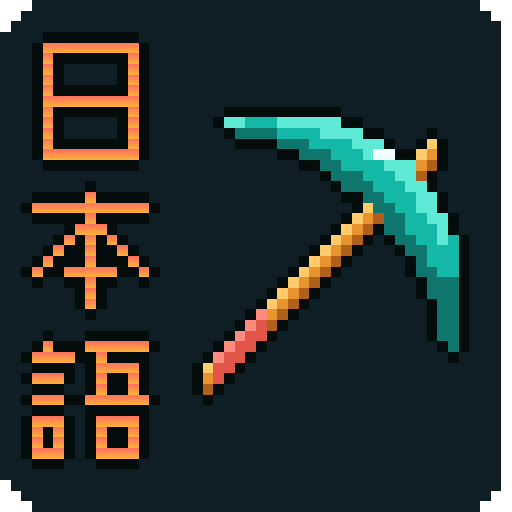
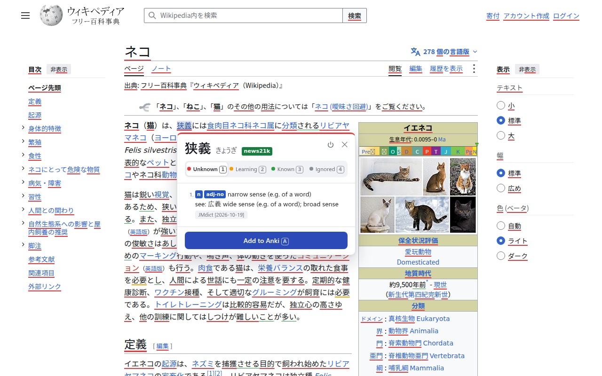
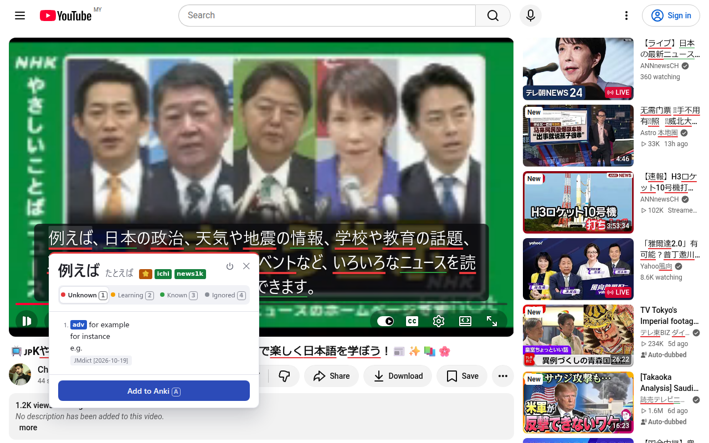
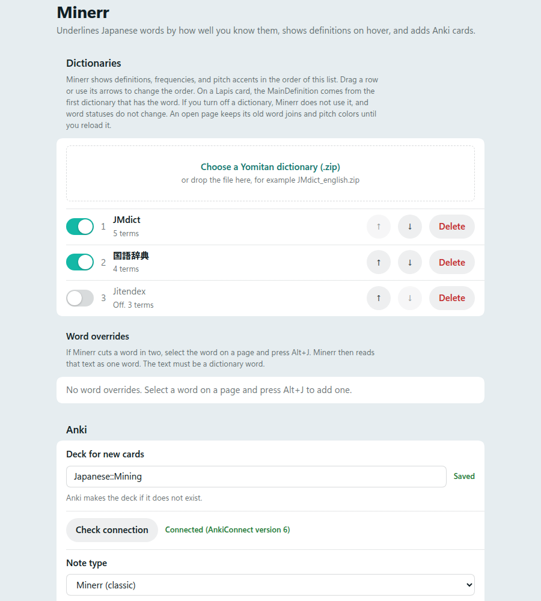
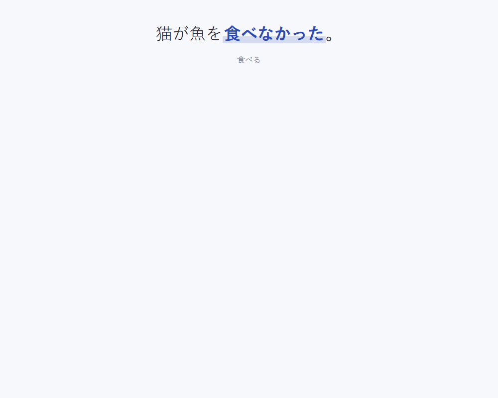
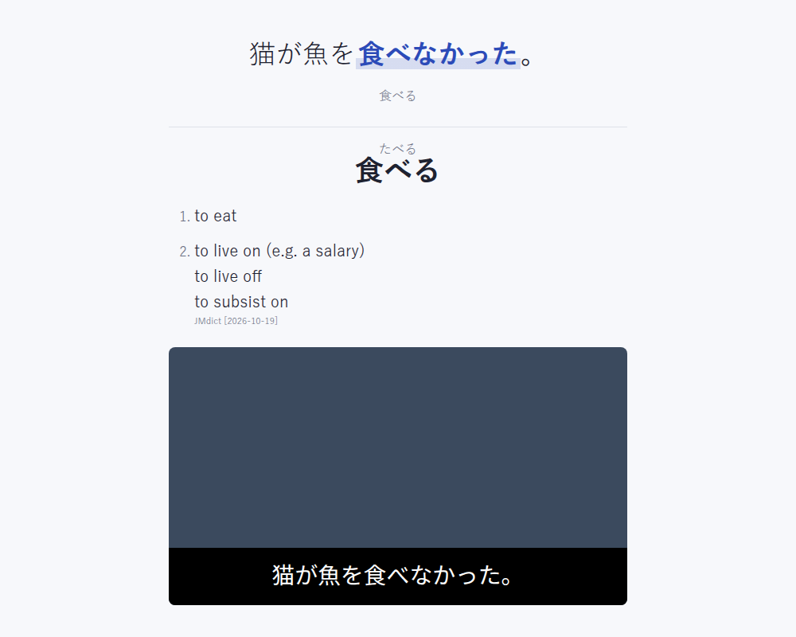

# Minerr

<p align="center"></p>

Minerr is a Chrome extension for Japanese sentence mining. It's a personal project: I built it for my own study, and it comes with no support and no guarantee.

Sentence mining means learning vocabulary from real Japanese content. You read or watch something, and when you hit a word you don't know, you make a flashcard from the sentence it's in. Then you review the card in Anki.

Minerr handles that loop in the browser:

1. It splits Japanese text into words with the [kuromoji](https://github.com/takuyaa/kuromoji.js) tokenizer. It reads the subtitles over a video on any site, and the page text on sites you turn on.
2. It underlines each word in the color of its status: unknown, learning, known or ignored.
3. When you hover over a word, it shows the dictionary definitions with their tags, for example `n` (noun) and `⭐` (high priority).
4. One key press makes an Anki card with the word, its reading, the sentence, the definitions and a screenshot of the tab.





The first screenshot is the Japanese Wikipedia article [ネコ](https://ja.wikipedia.org/wiki/%E3%83%8D%E3%82%B3) (CC BY-SA 4.0). The second is the video player with a test clip and a subtitle file.

## Features

- Parses the text of a page, including text that loads later. Page text is off on every site until you turn it on with `Alt+Shift+D` or from the toolbar menu. The subtitle overlay works everywhere.
- Treats a verb or adjective and its inflections as one word. 食べなかった is one word, with the dictionary form 食べる.
- Joins nouns into the longest word the dictionary knows. 食肉目ネコ科ネコ属 becomes three words: 食肉目, ネコ科 and ネコ属.
- Gives all spellings of a dictionary word one shared status, so 猫, ねこ and ネコ count as the same word.
- Reads text across inline markup. In `<ruby>暖<rt>あたた</rt></ruby>かくて`, 暖かくて is one word with the dictionary form 暖かい. The ruby text あたた isn't parsed and doesn't end up in the card sentence.
- Looks up definitions in a Yomitan dictionary that you import, such as JMdict.
- Colors dictionary tags the way Yomitan does. Word tags, like `⭐` (high priority) and `ichi` or `news13k` (frequent), sit next to the reading. Definition tags, like `v1` (Ichidan verb) and `uk` (usually in kana), sit before each definition. Hover over a tag to see what it means.
- If a word has several readings across your dictionaries, the popup shows each reading with its own definitions.
- Stores word statuses in the browser. A status change updates the underlines in every open tab immediately.
- Sends cards to Anki through AnkiConnect, by default to the Lapis note type from the [mining guide](https://learnjapanese.moe/mining/). It creates the deck if it doesn't exist.
- Lets you edit any field of a card before it goes to Anki.
- Can mark the words from your mature Anki cards as known.
- On YouTube, shows the subtitles in its own large overlay at the bottom center of the video, where you can look up and mine words. The overlay also works on other video sites and on video files from your computer.
- On Netflix, shows the title's Japanese subtitles in the overlay, with their times. The keys, play modes and subtitle sidebar work the same as on YouTube. Netflix cards get no line audio and no screenshot, because the video is DRM-protected.
- Adds the audio of the subtitle line to a card mined from a subtitle.
- Can generate Japanese subtitles for a YouTube video with WhisperX, running in a small server on your computer.
- Shows a comprehension score for each page or video.
- Has a word browser for finding, sorting and changing word statuses, and for adding a list of words you already know.
- Has a reader for `.epub`, `.txt`, `.srt` and `.vtt` files, with vertical text, and a page for pasted text.

Everything stays on your computer, with two exceptions. The extension talks to AnkiConnect at `http://127.0.0.1:8765` and to the optional WhisperX server at `http://127.0.0.1:8766`, both local. When you add a card with word audio, it sends the word and its reading to JapanesePod101 (`assets.languagepod101.com`); you can turn word audio off in **Options** (see [Word audio](#word-audio)). And when you click **Install Lapis**, Anki downloads the Lapis package from GitHub.

## Install

You can install Minerr from the Chrome Web Store or load it unpacked.

- **Chrome Web Store.** Open [Minerr in the Chrome Web Store](https://chromewebstore.google.com/detail/minerr/ikpmeofnjpikdoajmibnhkcnmgjkkmkl), click **Add to Chrome**, and skip to step 3. The store version doesn't include the WhisperX add-on; see [Generate subtitles with WhisperX](#generate-subtitles-with-whisperx).
- **Load unpacked.** Download `minerr-v<version>.zip` from the [Releases](https://github.com/haziqhilmismail/minerr/releases) page and unzip it, then skip to step 2. The zip contains one folder, `minerr`, and the same zip works on every platform. To build from source instead, start at step 1.

### 1. Build the extension

You need [Node.js](https://nodejs.org/) 24 or later.

```sh
git clone https://github.com/haziqhilmismail/minerr.git
cd minerr
npm ci
npm run build
```

The build compiles the TypeScript and writes the extension to the `dist` folder.

On WSL, Chrome on Windows has to load the extension from a Windows folder, so build it and copy `dist` over:

```sh
npm run build && mkdir -p /mnt/c/Users/<you>/minerr && cp -r dist/. /mnt/c/Users/<you>/minerr/
```

### 2. Load the extension in Chrome

1. Open `chrome://extensions`.
2. Turn on **Developer mode**.
3. Click **Load unpacked**.
4. Select the `minerr/dist` folder, or the `minerr` folder from a release. On WSL, select the Windows folder.

When you pull a new version, run `npm run build` again (and on WSL, copy `dist` again with the command above). Then click the reload button on the extension's card.

Chrome derives an unpacked extension's ID from its folder path. If you load Minerr from a different folder, it gets a new ID and starts with no data, so you'll have to import the dictionary again. To get your known words back, use **Import known words** (see below).

### 3. Install AnkiConnect

1. In Anki, click **Tools > Add-ons > Get Add-ons**.
2. Enter the code `2055492159`.
3. Restart Anki. AnkiConnect only starts when Anki starts.
4. Keep Anki open while you add cards.

AnkiConnect accepts requests from browser extensions by default. If the popup shows an AnkiConnect error, open **Tools > Add-ons > AnkiConnect > Config** and add `chrome-extension://<extension id>` to `webCorsOriginList`. You'll find the extension ID on the `chrome://extensions` page.

### 4. Import a dictionary

1. Download [`JMdict_english.zip`](https://github.com/yomidevs/jmdict-yomitan/releases/latest/download/JMdict_english.zip) from the jmdict-yomitan project.
2. Open the options page: in `chrome://extensions`, click **Details** on Minerr, then **Extension options**.
3. In **Dictionaries**, select the zip file or drop it on the import area.
4. Wait for `Imported JMdict [...]: ... terms`. The import takes about a minute.

You can import other Yomitan term dictionaries the same way. Importing a dictionary with the same title again replaces the old copy.

Minerr shows the tags from all your dictionaries.

To check the Anki side, click **Check connection** in the **Anki** section of the options page. It should say `Connected (AnkiConnect version 6)`.



### Upgrade from an earlier version

Most updates need nothing from you. A few changes do:

- **Dictionaries imported before spellings shared a status.** Import JMdict again. The new import keeps each word's entry number, which lets the spellings of a word share one status. Until you do, its row on the options page says `Import again so that the spellings of a word share one status.` See [Spellings of one word](#spellings-of-one-word).
- **Dictionaries imported before tags were shown.** These have no tags, and their row says `Import again to show tags.` Import the zip again to get them.
- **Statuses stored under a kana spelling.** Older versions stored a status under the spelling of the dictionary form, for example ねこ. After a dictionary import finishes, Minerr moves each status to its word's key, for example from ねこ to 猫. It does this once per set of dictionaries.
- **Page text that was on everywhere.** Older versions had page text on for every site and kept a list of sites where it was off. Minerr ignores that list now, so every site starts with page text off.
- **The new `SentenceAudio` field.** If your note type comes from an older version, Anki asks for a full sync once after the update. Sync all your devices before you update Minerr. See [The note type](#the-note-type).
- **Your note type choice.** If you picked a note type other than Lapis in an older version, Minerr keeps it.
- **WhisperX subtitles with long lines.** Subtitles from an older version of the server have long lines. To get short ones, click **Generate with WhisperX** again.

## Use

### Read and set statuses

Minerr only reads page text on sites you turn on:

1. Open a page with Japanese text.
2. Press `Alt+Shift+D`, or click the Minerr button in the Chrome toolbar and turn on **Words on the page**.

Every unknown word on the page gets an underline; other words show theirs when you hover over them. The subtitle overlay and Minerr's own pages don't need this switch. See [Turn the page text on or off for a site](#turn-the-page-text-on-or-off-for-a-site).

| Status | Underline | Meaning |
| --- | --- | --- |
| Unknown | Red, always. Thicker under the mouse. | The default. You don't know the word yet. |
| Learning | Orange, under the mouse only | You're studying the word. |
| Known | Thin green, under the mouse only | You know the word. |
| Ignored | None | You don't want to study it, for example a name. |

Words that Minerr has read get the hand cursor. Rest the mouse on a word and its popup opens after 0.3 seconds. To open it immediately, hold `Shift` while the mouse is on the word. To change when the popup opens, see [Word popup](#word-popup). The popup doesn't open while text is selected or a mouse button is held down.

These keys work on a word. The status keys, `1` to `4`, work even with no popup open; `A`, `E`, `V` and `Esc` need the popup.

| Key | Action |
| --- | --- |
| `1` | Set the word to unknown. |
| `2` | Set the word to learning. |
| `3` | Set the word to known. |
| `4` | Set the word to ignored. |
| `A` | Add an Anki card. |
| `E` | Edit the card, then send it to Anki. See [Edit a card before you add it](#edit-a-card-before-you-add-it). |
| `V` | Show the word's notes in the Anki browser. See [Is the word in Anki?](#is-the-word-in-anki). |
| `Esc` | Close the card form, or close the popup. |

A status key changes the first of these that applies:

1. The words in a text selection.
2. The word of a popup that a key opened (`N`, `Alt+S` or a play mode), until the mouse moves onto or off a word.
3. The word under the mouse, whether or not it has a popup. If no popup shows the word, a short message confirms the change.
4. The word of the popup under the mouse.

If none of these applies, the page gets the key. On YouTube, for example, `1` to `4` jump to 10% to 40% of the video. An open popup doesn't take the status keys unless the mouse is on it.

The keys don't work while the focus is in a text field.

### Spellings of one word

A status belongs to a word, not to a spelling, and a word is one JMdict entry. The entry 猫, for example, has the spellings 猫 and ネコ and the reading ねこ. Set 猫 to known and ねこ and ネコ become known too.

Minerr finds the entry from the dictionary form and reading of the word on the page:

- If exactly one entry fits, all its spellings share one status.
- If several entries fit, the spelling keeps its own status. かみ, for example, can be 紙, 神 or 髪.
- If one spelling has two readings in two different entries, each entry has its own status. 上手 (じょうず) and 上手 (うわて) are two words.
- If none of your dictionaries has entry numbers, every spelling has its own status.

The status key is the text Minerr stores for a word. It's the entry's headword, for example 猫. If a more common entry has the same headword, the key adds the reading, as in `上手【うわて】`. You'll see these keys in the status file and the word browser.

The popup shows the entry's headword and reading. If the spelling on the page is different, the popup shows that too, for example `On the page: ネコ`.

If two spellings of one word have different statuses, the word takes the higher one. Known ranks highest, then ignored, then learning, so merging never turns a known word back into unknown or learning. Importing a status file follows the same rule.

### Mark words in bulk

1. Select text on the page with the mouse.
2. Press a status key, `1` to `4`.

Every word the selection touches gets that status, and a short message at the bottom of the page shows the count, for example `Marked 5 words as known.` A selection takes priority over an open popup.

### Close the popup or turn Minerr off

- To close the popup, press `Esc`, click outside it, or click **✕** in its top-right corner.
- To turn Minerr off in every tab, click the power button in the popup or press `Alt+Shift+M`. The underlines and the popup go away immediately.
- To turn it back on, press `Alt+Shift+M`, or open the toolbar menu and turn on the switch next to **Minerr** at the top. The switch then says **On**.

While Minerr is off, YouTube shows its own captions again and the subtitle overlay is hidden.

This is handy when you want to compare Minerr with another dictionary extension, such as Yomitan. To change the shortcut, see [Change a shortcut](#change-a-shortcut).

### Browser shortcuts

Chrome handles these keys itself, so a web page can't intercept them. The table shows the defaults.

| Key | Action |
| --- | --- |
| `Alt+Shift+M` | Turn Minerr on or off in all tabs. |
| `Alt+S` | Look up the selected text. See [Look up selected text](#look-up-selected-text). |
| `Alt+J` | Make the selected text one word, or remove that word override. See [Word overrides](#word-overrides). |
| `Alt+Shift+D` | Turn page text on or off for this site. |
| No key | Open the Minerr toolbar menu. |
| No key | Turn the sentence highlight on or off. `Alt+Shift+S` on a page does this too. |

If Chrome, your system or another extension already uses a key, Minerr doesn't get it. The options page lists the keys Minerr actually has under **Colors and shortcuts**, and shows **Not set** for any it couldn't get. The toolbar menu also shows the keys for the Minerr switch and the **Words on the page** switch.

#### Change a shortcut

1. Open the options page.
2. In **Colors and shortcuts**, click **Change the keys**, or open `chrome://extensions/shortcuts` in a new tab.
3. Find **Minerr** in the list.
4. Click the pencil button next to the action.
5. Press the new key, for example `Alt+K`. It has to start with `Alt` or `Ctrl`.

The new key works right away in every tab.

### Turn the page text on or off for a site

Page text is off on every site until you turn it on. While it's off, Minerr doesn't parse the page and shows no underlines or popups for its text.

These parts of Minerr work without the switch, as long as Minerr itself is on:

- The subtitle overlay on YouTube and other video sites, with its line list. Its words get underlines, the popup, the keys, the i+1 highlight and cards.
- Minerr's own pages: the player, the reader, the paste page and the word browser.

To turn page text on for a site, either:

- Press `Alt+Shift+D` on any page of the site. A short message at the bottom confirms it, for example `Minerr page text on for ja.wikipedia.org.`
- Or open the toolbar menu and turn on **Words on the page** in the site's card, for example **On ja.wikipedia.org**. The card's **Video subtitles** row shows that subtitles work without this switch.

A site includes its subdomains, and Minerr ignores `www.`. Turn page text on at `www.youtube.com` and it's on for all of `youtube.com`, including `m.youtube.com`.

Minerr remembers the choice for every page of that site, even after Chrome restarts, and other sites aren't affected. To turn it off again, press `Alt+Shift+D` or flip the switch again; Minerr removes its underlines from the page immediately.

### Mine a sentence

1. Find an unknown word in a sentence.
2. Hover over the word.
3. Press `A`.

Minerr hides the popup, takes a screenshot of the tab and adds the card to Anki. If the word was unknown, it becomes learning.

The card's sentence is the one that contains the word. Minerr cuts it at `。`, `！`, `？` and line breaks, keeps closing quotes such as `」` attached, and puts the word in bold.

### Edit a card before you add it

1. Hover over a word.
2. Press `E`, or click **Edit** in the popup.
3. Change the fields in the card form.
4. Click **Send**.

Minerr takes the screenshot and records the audio as soon as you press `E`. The form shows every field of the note type with its content as HTML; the word in the sentence is wrapped in `<b>`. Below the fields you'll see the screenshot and an audio player for each audio file. **Send** adds the note with your edits, and Minerr only stores the files that a field still refers to.

To close the form without making a card, click **Cancel** or press `Esc`. A second `Esc` closes the popup. The popup keys are disabled while you type in the form, and no other popup opens while it's open.

The form works with Lapis, with the classic note type and with your own note type.

### Import known words from Anki

1. On the options page, go to **Known words**.
2. Enter an Anki search and the name of the field that holds the word.
3. Click **Import known words**.

Every word from the matching cards becomes known. If a dictionary has the word, Minerr uses its entry's status key, so 猫科 becomes ネコ科. The default search is `deck:"Minerr" prop:ivl>=21`, which finds cards with an interval of 21 days or more. The default field is `Word`.

## Find i+1 sentences

An i+1 sentence has exactly one unknown word. You know everything else in it, which makes it a good card. Minerr gives each i+1 sentence a soft yellow background.

- Only words with a red underline count as unknown. Learning, known and ignored words don't.
- A sentence needs at least two words, so a lone word such as a link or menu item never gets highlighted.
- Sentences are cut the same way as card sentences: at `。`, `！`, `？` and line breaks.
- The highlight also shows in the subtitle overlay on YouTube and in the video player.
- When a word's status changes, the highlight updates in every open tab.

The highlight doesn't modify the page; it uses the CSS Custom Highlight API.

To turn it off or on:

1. Click the Minerr button in the Chrome toolbar.
2. Click the **Highlight i+1 sentences** switch.

You can also use **Highlight i+1 sentences** under **Word popup** on the options page.

Turning Minerr off removes the highlight too.

## Comprehension score

The toolbar menu shows how much of the current tab you understand.

1. Open a page with Japanese text on a site with page text on, or a YouTube video.
2. Click the Minerr button in the Chrome toolbar.

The **Comprehension** section shows:

- The score: the percentage of words that are known or ignored. Learning words don't count as understood.
- A label for the score, borrowed from Migaku (see the table below).
- How many different words have each status.

| Score | Label |
| --- | --- |
| 99% or more | Exceptional |
| 95% to 98% | Excellent |
| 90% to 94% | Great |
| 80% to 89% | Good |
| 70% to 79% | Approachable |
| 60% to 69% | Challenging |
| Less than 60% | Ambitious |

On a video with timed subtitles, the score covers every subtitle line in the video. Timed subtitles means WhisperX subtitles, YouTube subtitles with times, or a subtitle file in the player. The score is ready as soon as the subtitles load, before you press play, and the menu says "N words in all M subtitle lines of the video."

If a YouTube video only has the YouTube captions in the overlay, the score covers only the lines the overlay has shown in this tab, so it changes as you watch and starts over when you open another video. The menu then says "N words in the M subtitle lines that the overlay showed."

Migaku also factors the number of i+1 sentences into its score. Minerr only uses the percentage of words.

## Subtitles on YouTube

On a YouTube video page, Minerr shows the subtitles in its own overlay: large white text on a dark box at the bottom center of the video, above the player controls. The text scales with the player, including theater mode and full screen. Minerr hides YouTube's own captions, since the overlay shows the same text.

Open a video that has Japanese captions. After a few seconds, the overlay shows them in sync with the video. You don't need the Minerr server, and you don't need to turn on **CC**. [YouTube subtitles with times](#youtube-subtitles-with-times) explains how this works.

If Minerr can't get captions with times, the overlay copies whatever the YouTube player shows instead:

1. Turn on captions in the YouTube player: click **CC** or press `C`.
2. If the video has several caption tracks, pick the Japanese one in **Settings > Subtitles/CC**.

With captions off, the overlay shows nothing. When a caption has two lines, the overlay shows two lines.

Overlay text counts as page text: Minerr underlines its words, and the popup and keys work on it. Pause the video and hover over a word. If you press `A`, the `Sentence` field gets the overlay line that contains the word.

You can also work through a line with the keyboard:

- Press `N` to open the popup of the line's first unknown word, and `N` again to move to the next one. After the last unknown word, `N` wraps back to the first. If no popup is open, YouTube gets `Shift+N` (next video).
- Hover over a word and press a status key, `1` to `4`, to set it without opening the popup. See [Read and set statuses](#read-and-set-statuses).

These keys work in the Minerr video player too. If the mouse isn't on a word, the page gets the status key, so YouTube's number keys still work. If the line has no unknown word, the page gets `N`.

### YouTube subtitles with times

Subtitles with times unlock the keys that jump between lines, the play modes, the subtitle sidebar, the score over all lines, and sentence audio. Captions that Minerr copies from the YouTube player have no times, so none of these work with them.

Minerr gets timed Japanese subtitles in two ways and uses whichever arrives first:

- **In the tab, without the server.** The YouTube player on the page fetches the captions from YouTube, and Minerr reads them. If **CC** is off, Minerr selects the Japanese track in the player itself. YouTube's captions stay hidden under the overlay.
- **From the Minerr server.** The server downloads the subtitles with `yt-dlp`. You only need this when YouTube doesn't send the captions to the tab.

Once subtitles are showing, they don't change, except that WhisperX subtitles replace them when they're ready.

To get subtitles from the server:

1. Start the server, as described in [Generate subtitles with WhisperX](#generate-subtitles-with-whisperx).
2. Open a YouTube video.
3. Wait a few seconds while the server downloads the subtitles with `yt-dlp`.

If you start the server after opening the video, the tab finds it within a few seconds. You don't need to reload.

Both ways prefer the uploader's subtitles and fall back to YouTube's automatic ones. YouTube splits automatic subtitles into short rows, often mid-sentence, so Minerr rejoins the rows into sentences using each word's timing. The overlay then shows them in sync with the video, even with YouTube's captions off. If the video has no Japanese subtitles at all, the overlay copies the YouTube captions as described above.

Japanese subtitles are never a machine translation. YouTube auto-translates its automatic captions into every language, so even an English video has "Japanese" captions. Minerr skips those, and the overlay shows no Japanese subtitles on such a video. YouTube can also dub a video into Japanese with a synthetic voice; the automatic captions of that voice are a machine translation too, so Minerr skips them as well. The second subtitles, such as English, can be a translation.

The server caches subtitles in `~/.cache/minerr/subs/<video id>.captions.ja.v2.json`. For a video with no Japanese subtitles, the file contains `{}`. After a day, the server checks with YouTube again, because YouTube sometimes adds automatic subtitles a few hours after upload. To force a fresh download, delete the file.

## Generate subtitles with WhisperX

Some videos have no Japanese captions, or bad ones. For those, Minerr can transcribe the audio with [WhisperX](https://github.com/m-bain/whisperX), which runs in a small server on your computer.

The server does more than WhisperX. It gives Minerr:

- Japanese subtitles from WhisperX, which are much better than YouTube's automatic ones.
- Timed subtitles from YouTube and other video sites, through `yt-dlp`. The subtitle sidebar, the score over all of a video's lines, and sentence audio all need those times. See [Subtitles on YouTube](#subtitles-on-youtube) and [Subtitles on other video sites](#subtitles-on-other-video-sites).
- Sentence audio for cards, as MP3 files at an even loudness. Without the server, the video replays the line while the tab records it. See [Sentence audio](#sentence-audio).

The toolbar menu shows a short version of this list above the server status.

### Get the WhisperX add-on

The server and its Windows launcher make up the WhisperX add-on. A source checkout and the `minerr` folder from `minerr-v<version>.zip` already include it. If you installed Minerr from the Chrome Web Store, get the add-on from GitHub:

1. Open the [latest release](https://github.com/haziqhilmismail/minerr/releases/latest). The **Get the WhisperX add-on** button in the toolbar menu opens the same page.
2. Download `minerr-whisperx-v<version>.zip` and unzip it. It contains one folder, `minerr-whisperx`.
3. Move the folder somewhere it can stay, such as your user folder.

The release page has install steps for each platform. In this section, "the add-on folder" means the `minerr-whisperx` folder, or the Minerr folder of an unpacked install.

### Requirements

- Windows on x64, or Linux. On Windows on ARM, run the server in WSL using the Linux steps.
- [uv](https://docs.astral.sh/uv/), which installs Python 3.12, WhisperX, PyTorch, `yt-dlp` and `ffmpeg` for the server. On Windows, `Start WhisperX server (Windows).cmd` downloads uv for you if it's missing.
- If `yt-dlp` and `ffmpeg` are on your `PATH`, the server uses them. Otherwise it uses its own copies: the `yt-dlp` package and the `ffmpeg` from the `imageio-ffmpeg` package. `yt-dlp` uses Node.js for YouTube's JavaScript challenges if Node.js is on the `PATH`.
- About 4 GB of free memory. The server uses about 3.5 GB with the default model.
- About 5 GB of free disk space on Linux, or 6 GB on Windows.

The server runs on the CPU and doesn't need a GPU, so it also works on machines with an AMD GPU or without CUDA.

### Start the server

On Windows, the add-on folder contains the launcher `Start WhisperX server (Windows).cmd`. On Linux and WSL, you start the server with a command (see below).

On Windows, click the Minerr button in the Chrome toolbar, then **Start the server**. A window opens and the server runs in it. Keep the window open while you use the server; close it to stop the server.

The button only works after you've double-clicked the launcher once. Until then, the toolbar menu of an unpacked Minerr walks you through it:

1. Click **Show the Minerr folder**. Minerr's page in `chrome://extensions` opens.
2. Click the path after **Loaded from**. The Minerr folder opens.
3. Double-click `Start WhisperX server (Windows).cmd`. The server starts, and the button is now set up.

If you installed from the Chrome Web Store, the toolbar menu shows **Get the WhisperX add-on** instead of **Show the Minerr folder**. It opens the latest release on GitHub. Download and unzip the add-on, then double-click the launcher in the `minerr-whisperx` folder. While the server is off, a store install also shows this button under **Start the server**.

Every run of the launcher points the button at its own folder, so the button always starts the launcher you double-clicked last.

If the server doesn't answer within 90 seconds of clicking **Start the server**, the toolbar menu tells you; check the server window for the error. If you move the add-on folder, double-click the launcher in its new location once. If the button still doesn't work after that, start the server by double-clicking the launcher.

<details>
<summary>What the Windows launcher does, and how to remove it</summary>

`Start WhisperX server (Windows).cmd` needs no admin rights and doesn't change your `PATH` or any other Windows setting. It:

1. Looks for uv on your `PATH` or in `%LOCALAPPDATA%\Minerr\uv`. If it can't find it, it asks first. When you press Y, it downloads uv 0.13.5 (15 MB) from GitHub with `curl.exe`, checks the file's SHA-256, and unpacks it to `%LOCALAPPDATA%\Minerr\uv`.
2. Sets up the **Start the server** button.
3. Fetches the newest `yt-dlp`, because YouTube often breaks old versions. If you're offline, the server starts with the `yt-dlp` it already has, as long as it has started once with internet access from the same add-on folder.
4. Starts the server. On the first start, uv downloads Python 3.12 and the server's packages.

To set up the button, the launcher writes two things for Chrome:

- The file `%LOCALAPPDATA%\Minerr\com.minerr.whisperx.json`. It names the host in the add-on folder, `server\start-from-chrome-windows.cmd`, and the extensions allowed to use it: Minerr from the Chrome Web Store, plus the unpacked extension in the add-on folder if there is one.
- The registry value `HKEY_CURRENT_USER\Software\Google\Chrome\NativeMessagingHosts\com.minerr.whisperx`, which points at that file.

When you click **Start the server**, Chrome runs the host, and the host opens its launcher in a separate window.

The launcher keeps Python's bytecode in `%LOCALAPPDATA%\Minerr\pycache`, so the add-on folder never changes. It doesn't work on Windows on ARM, because ctranslate2, the engine behind WhisperX, has no build for it; use WSL with the Linux steps there.

To remove what the launcher wrote, run these in a Command Prompt. `%LOCALAPPDATA%\Minerr` holds the file for Chrome, plus the launcher's uv and bytecode.

```bat
reg delete HKCU\Software\Google\Chrome\NativeMessagingHosts\com.minerr.whisperx /f
rmdir /s /q %LOCALAPPDATA%\Minerr
```

The launcher also fills uv's cache in `%LOCALAPPDATA%\uv` and uv's Python in `%APPDATA%\uv\python`, and the model lives in `%USERPROFILE%\.cache\huggingface`. If you don't use uv or Hugging Face for anything else, delete those folders too.

</details>

On Linux and WSL, run this in the add-on folder and keep the terminal open while you use the server:

```sh
uv run server/whisper_server.py
```

If `yt-dlp` isn't on your `PATH`, the server uses the `yt-dlp` package in its own environment. To update it, run `uv sync --script server/whisper_server.py --upgrade-package yt-dlp`.

The first start installs about 2.6 GB of packages on Linux, or about 3.7 GB on Windows, and the first job downloads the model, about 1.6 GB more. In one test on Windows, the first job also sat for about 5 minutes before transcription started. That wait only happens once.

If the server runs in WSL, Chrome on Windows reaches it at `http://127.0.0.1:8766`, because WSL forwards localhost ports to Windows.

If the window or terminal says `Port 8766 is in use: the WhisperX server already runs, or another program uses the port.`, that's exactly what happened: only one server can run at a time.

To start the server automatically when you log in to Windows, put a shortcut to the launcher in your Startup folder:

1. Press Win+R.
2. Type `shell:startup`.
3. Press Enter. The Startup folder opens.
4. Right-click-drag `Start WhisperX server (Windows).cmd` from the add-on folder into the Startup folder.
5. Click **Create shortcuts here**.

The default model is `large-v3-turbo`. To use another one, add `--model`, for example `--model small`. `small` is about 2.5 times faster but makes more mistakes in Japanese; in testing it wrote 自身 for 地震, 部身 for 文, and 感じに振り金 for 漢字にふりがな.

The server uses one thread per CPU core. Add `--threads` to change that.

### Make subtitles for a video

1. Open the YouTube video.
2. Click the Minerr button in the Chrome toolbar. If you can't see it, click the extensions button and pin Minerr.
3. Click **Generate with WhisperX**.
4. Wait for `The WhisperX subtitles are ready.`

You can close the toolbar menu while the server works. The tab picks up the subtitles when the job finishes, and the overlay switches to them in sync with the video.

To go back to the YouTube captions, open the toolbar menu and click **YouTube captions**. Click **WhisperX** to switch back.

### Speed

On a Ryzen 5 7600X (6 cores), `large-v3-turbo` takes about 24 seconds per 100 seconds of audio, roughly 4 times faster than real time. A 20-minute video takes about 5 minutes. The `small` model takes about 10 seconds for the same audio.

### Cache and privacy

Each subtitle line is at most about 8 seconds of speech, which is one or two lines of text. WhisperX splits the audio at pauses, and each piece becomes a line.

The server caches subtitles in `~/.cache/minerr/subs/<video id>.<model>.8s.json`, so reopening a video shows them instantly. Delete the file to make new ones.

It also keeps each video's audio in `~/.cache/minerr/audio/` for the cards' sentence audio. A 20-minute video takes about 20 MB. Delete the files in that folder to free the space.

On Windows, `~` is your user folder, for example `C:\Users\<you>`.

The audio stays on your computer. Only `yt-dlp` connects to YouTube, to download it. WhisperX downloads its models from Hugging Face the first time. The server only accepts connections from your own computer. The Windows launcher downloads uv from GitHub once, uv downloads Python and the packages from the internet, and every start of the Windows launcher asks PyPI for a newer `yt-dlp`.

## Mine a local video

You can mine a video file from your computer. The Minerr video player shows the subtitles in the same large overlay as on YouTube.

1. Click the Minerr button in the Chrome toolbar.
2. Click **Play a local video**. The player opens in a new tab.
3. Drop a video file on the page, or click **Choose a video**.
4. To use a subtitle file, drop it together with the video or click **Add subtitle file**. Minerr reads `.srt` and `.vtt`. For a second subtitle file under the line, such as English, click **Add second subtitle file**.
5. Pause the video and hover over a word in the subtitles.
6. Press `A` to add an Anki card.

The `Sentence` field gets the subtitle line containing the word, and the `Image` field gets a screenshot of the player tab.

Chrome plays MP4 and WebM. If it can't play your file, the player shows an error; convert the file to MP4 or WebM, for example with `ffmpeg -i video.mkv video.mp4`.

For full screen, click **Full screen**. The video controls' own full-screen button would show the video without subtitles, so the player removes it.

### Make subtitles with WhisperX

No subtitle file? The WhisperX server can make one. Start the server first, as described in [Generate subtitles with WhisperX](#generate-subtitles-with-whisperx).

1. Open the video in the player.
2. Click **Generate with WhisperX**.
3. Wait for `WhisperX subtitles: <number> lines.`

The player sends the video file to the server on your computer; it doesn't go to the internet. The server extracts the audio with ffmpeg, transcribes it, and deletes its copy of the file when the job ends.

Keep the player tab open while the server works. If you close it, open the video again and click **Generate with WhisperX** again. The server caches the subtitles in `~/.cache/minerr/subs/<SHA-256 of the file>.<model>.8s.json`, so it never transcribes the same file twice.

### Save the subtitles

Click **Save subtitles** to download the WhisperX subtitles as an `.srt` file named after the video, for example `lesson.srt` for `lesson.mp4`. Keep it in the same folder as the video. Next time, open the video and the `.srt` file together and you won't need the server. Most video players also pick up an `.srt` file with the same name as the video.

## Subtitles on other video sites

Minerr can put its subtitle overlay on a video on any page, not just YouTube.

1. Open the page with the video.
2. Click the Minerr button in the Chrome toolbar.
3. Click **Subtitles for the video of this page**. Minerr puts its overlay on the largest video on the screen.
4. Click one of the buttons at the top left of the video:
   - **Subtitle file** loads an `.srt` or `.vtt` file from your computer.
   - **Subtitles of the site** asks the Minerr server for the page's Japanese subtitles. The server uses `yt-dlp`, which supports many video sites.
   - **WhisperX** transcribes the page's audio. The server downloads the audio with `yt-dlp`.
5. To get rid of the buttons, click **Hide these buttons**. The overlay stays until you reload the page.

The keys, play modes, subtitle sidebar and sentence audio work the same as on YouTube.

Limits:

- `yt-dlp` can't download from sites with DRM; the overlay shows the server's error. Use a subtitle file if you have one. Sentence audio then comes from recording in the tab, if the site allows it.
- The video has to be in the page itself. Some sites play video inside a frame, and Minerr can't see a video in a frame.
- Minerr only copies the player's captions on YouTube and Netflix. On other sites it doesn't.

### Netflix

On a Netflix watch page, Minerr shows the title's Japanese subtitles in its overlay, with their times. You don't need the server and you don't need to click anything.

1. Open a title on netflix.com. The overlay shows the Japanese subtitles once the player starts.
2. If the player is showing Japanese subtitles, the overlay uses the same track. Otherwise it uses the regular Japanese subtitles in preference to the Japanese closed captions.
3. Turn on the second subtitles (`Shift+W`) to see the English track under the Japanese line.

How it works: the Netflix player asks Netflix for the title's list of subtitle tracks. Minerr reads that list in the tab, asks for the tracks in WebVTT format, and fetches the Japanese track from Netflix's servers the same way the player does. Minerr doesn't download the video or touch its DRM, and seeks from Minerr keys go through Netflix's own player.

Limits:

- The video has DRM, so Chrome gives an extension neither its sound nor its picture. A Netflix card gets the line as its sentence and word audio from JapanesePod101, but no line audio and no screenshot. The overlay tells you this when you add the card.
- Some Japanese titles have image-based subtitles. Minerr can't read those; the overlay says so and Netflix's own captions stay on.
- WhisperX doesn't work on Netflix, because the server can't download the audio.
- Forced subtitles (the few foreign-language lines in a film) aren't the dialogue, so the overlay skips them.
- On Netflix, the toolbar button **Subtitles for the video of this page** shows the overlay's state, such as the number of lines.

## Sentence audio

A card for a word in a subtitle line gets the whole line as its sentence, the same as asbplayer and Migaku. Minerr doesn't cut subtitle lines at `。`, `！` or `？`. On a web page, the card sentence still ends at `。`, `！`, `？` and line breaks.

When you add a card from the subtitle overlay, it also gets the line's audio, starting 0.5 seconds before the line and ending 0.5 seconds after. To change that, open the options page and adjust **Sentence audio padding** under **Video**.

The audio comes from one of two places:

1. The Minerr server cuts the line out of its copy of the audio as an MP3. This works for YouTube videos and for files you sent to the server with **Generate with WhisperX**. The first card from a video starts the audio download, and later cards from that video get MP3s.
2. If the server is off or doesn't have the video's audio, Minerr records the line in the tab: the video jumps back to the start of the line, plays it, and returns to where it was. That recording is a WebM file.

Minerr evens out the loudness of all sentence audio so no card is too loud or too quiet. The server sets each MP3 to -16 LUFS (EBU R128). A tab recording only gets its level evened out, so its start can be slightly louder or quieter. Changing the video's volume doesn't affect the recording.

Sentence audio needs subtitles with times. A card from YouTube captions that Minerr copied from the player has no sentence audio.

A DRM-protected video (Netflix and some other sites) gives a recording no sound and a screenshot no picture, so its cards get neither sentence audio nor a screenshot. They still get word audio from JapanesePod101 if the note type has a field for it. The overlay shows **Protected video: the card gets no line audio and no screenshot.**

Anki on a computer plays both MP3 and WebM. If a phone app won't play a WebM file, start the server before adding the card so it gets an MP3 instead.

## Play modes

A play mode pauses the video for you. Open the options page, go to **Video** and pick a **Play mode**:

| Play mode | The video pauses |
| --- | --- |
| **Normal** | Never. This is the default. |
| **Pause before each line** | At the start of each line. Read the line, then play the video to hear it. |
| **Pause after each line** | At the end of each line. The line stays on screen. |
| **Pause after i+1 lines** | At the end of each line with exactly one unknown word. |

Play modes need subtitles with times. Press `S` to hear the line again, or `→` or `D` to go to the next line.

Other settings under **Video**:

- **Play again after a pause of the play mode.** The video resumes after 3, 6 or 10 seconds, but not while the mouse is on the line or a word popup is open.
- **Open the first unknown word after a pause of the play mode.** Opens the popup of the line's first unknown word.
- **Pause while the mouse is on the subtitles.** The video pauses when the mouse moves onto the subtitle line and stays paused while a subtitle word's popup is open. It resumes once the mouse leaves and the popup closes. This is on by default.

## Subtitle sidebar

The subtitle sidebar lists every line of the video as a card. It opens in Chrome's side panel on the right of the window; Chrome narrows the page to make room, so the panel never covers anything. It needs subtitles with times.

- The panel belongs to the video's tab. Chrome hides it when you switch tabs and brings it back when you return.
- Chrome doesn't show side panels in full screen. The panel comes back when you leave full screen.
- The panel uses Minerr's theme colors (**Theme** on the options page), not the page's.

1. Press `G` on the video to open the sidebar.
2. Find a line. Each card shows the line and its time. Words have their status colors, and hovering over one opens its popup, just like in the overlay.
3. On the card, you can:
   - Click the card or its time to jump to the line.
   - Click **▶** to play the line once. The video pauses at the end of it.
   - Click **+** to add a card for a word in the line. The card gets the line as its sentence, the line's audio and a screenshot of the line. The video pauses at the start of the line for the screenshot.
   - Click **★** to bookmark the line.
4. Press `G` again, or click **×** at the top of the side panel, to close it.

Which word **+** makes a card for:

- If the line has one unknown word, Minerr adds that card straight away.
- If it has two or more, the card shows **Select a target word**, listing the unknown words first and then the rest of the line. Click a word to add its card.
- If it has no unknown word, the list shows every word in the line.
- To close the list, click **Cancel**, click **+** again, or press `Esc`. Use `Tab` and `Enter` to pick a word with the keyboard.

To add cards for many lines at once:

1. Tick the box to the left of each line's time. The bar at the bottom of the sidebar counts the selected lines.
2. Click **Create N cards**. Minerr adds one card per line, one after another, each with the line as its sentence, the line's audio and a screenshot of the line. The bar shows progress.
3. Check the result in the bar. A line that doesn't have exactly one unknown word gets no card, because only you can choose its target word; it stays selected, so use **+** on it.
   - If Anki returns an error, Minerr stops. The line's popup shows the error, and the lines without cards stay selected.
4. Click **Stop** to cancel the cards that haven't been added yet. To clear the selection, click **Clear**, or press `Esc` while the sidebar has focus.

The sidebar follows the video: the current line's card gets a teal border, and the list scrolls to keep it in view. When it stops following, it shows **Scroll paused**:

- While the mouse is over the list, it doesn't scroll. When the mouse leaves, the list stays put.
- If you scroll or click in the list, it stays where you left it. A pause for a popup doesn't change that.
- When you play the video, the list jumps to the current line and starts following again.
- When you click a card, its time, **▶** or **+**, the list jumps to that line and starts following again.

If the only subtitles are YouTube captions that Minerr copied from the player, the sidebar shows a message instead, because those captions have no times.

Pick a filter at the top of the sidebar:

| Filter | The sidebar shows |
| --- | --- |
| **All lines** | Every line. |
| **1+ unknown words** | Lines with at least one unknown word. |
| **2+ unknown words** | Lines with at least two unknown words. |
| **1 unknown word** | Lines with exactly one unknown word, counted the same way as the i+1 highlight. |
| **Unique 1 unknown word** | Lines with exactly one unknown word, but only the first line for each unknown word. |
| **Learning** | Lines containing a word with the status learning. |
| **All known** | Lines made up only of known or ignored words. |
| **Bookmarks** | Lines you bookmarked. The filter shows how many there are. |

If no line matches, the sidebar says so. Click **Clear filter** to show every line again.

To bookmark the current line, press `B` or click **★** on its card; press `B` again to remove it. Bookmarks are saved per video: by video ID on YouTube, and by name and size for a file.

When Minerr is off, the sidebar says so.

## Subtitle display

These settings live under **Video** on the options page and apply to the subtitle overlay on every video page.

- **Subtitle size.** Drag the slider to make the subtitles bigger or smaller. On a video, `Alt+=` and `Alt+-` change the same size.
- **Obscure the subtitles.** Blurs or hides the overlay text while the video plays; it shows again when you hover over it or pause. Choose **Blur** or **Hide**. Press `W` on a video to toggle this.
- **Second subtitles.** Shows a second track, such as English, under the Japanese line. Choose **Show**, **On hover or pause** or **Off** (the default). Press `Shift+W` on a video to show or hide it. On YouTube, Minerr fetches the English subtitles the same two ways as the Japanese ones; if the video has none, YouTube translates the Japanese subtitles. In the video player, click **Add second subtitle file**.
- **Remove bracketed text.** Strips text in brackets, such as （笑）, (laughs), [音楽] and 【拍手】. A line made up only of bracketed text isn't shown.
- **Parts with no subtitles.** For any stretch of 1.5 seconds or more without a line, the video plays at 2× or 4× speed, or skips ahead. The last 0.5 seconds before the next line play at normal speed. This needs subtitles with times.

## Video keys

These keys work on any video with the Minerr subtitle overlay: on YouTube, in the video player and on other sites. They don't work while the focus is in a text field.

| Key | Action | Note |
| --- | --- | --- |
| `→` or `D` | Go to the next line. | Needs subtitles with times. |
| `←` or `A` | Go to the previous line. If a word popup is open, `A` adds the word's card instead. | Needs subtitles with times. |
| `S` | Replay the current line. | Needs subtitles with times. |
| `Alt+A` | Go back 5 seconds. | |
| `Alt+D` | Go forward 5 seconds. | |
| `C` | Copy the current line. | |
| `J` | Join the next line to the current one. A card then gets both lines as its sentence, with the audio of both. Press `J` again to stop. | Needs subtitles with times. |
| `G` | Open or close the subtitle sidebar in Chrome's side panel. With YouTube captions that have no times, the sidebar shows a message. | |
| `B` | Bookmark the current line, or remove its bookmark. | Needs subtitles with times. |
| `.` | Step one frame forward. The video pauses. | Needs subtitles with times. |
| `,` | Step one frame back. The video pauses. | Needs subtitles with times. |
| `Alt+O` | Show the subtitles 0.1 seconds later. | Needs subtitles with times. |
| `Alt+I` | Show the subtitles 0.1 seconds earlier. | Needs subtitles with times. |
| `Alt+=` | Make the subtitles bigger. | |
| `Alt+-` | Make the subtitles smaller. | |
| `Shift+W` | Show or hide the second subtitle track. | Needs subtitles with times. |
| `W` | Blur or hide the subtitles until you hover over them or pause, or show them again. | |

Subtitles with times come from WhisperX, from a subtitle file, or from YouTube subtitles that Minerr reads in the tab or that the server downloads. Captions that Minerr copies from the YouTube player have no times; with those, a key that needs times shows a hint and YouTube gets the key.

YouTube uses some of these keys too, such as `C`, `J`, `.`, `,` and the arrow keys. While the overlay is showing subtitles, Minerr's action wins. `C` only copies a line when the overlay is showing one; otherwise YouTube gets `C` and toggles its captions.

The offset applies to the open video until you open another one. The text size applies to all videos and is saved.

The options page lists these keys too, under **Colors and shortcuts**.

## Read a file

The Minerr reader shows the text of a book or a subtitle file. Words get underlines, and the popup, the keys and the i+1 highlight work just like on a web page.

1. Click the Minerr button in the Chrome toolbar.
2. Click **Read a file**. The reader opens in a new tab.
3. Drop a file on the page, or click **Choose a file**.

The reader opens these files:

| File | Content |
| --- | --- |
| `.epub` | Each chapter of the book. The **Chapter** list shows each chapter's first heading. |
| `.txt` | Each line with text is a paragraph. Long files are split into parts of about 10,000 characters. |
| `.srt`, `.vtt` | Each subtitle is a paragraph. The times aren't shown. |

From an EPUB, the reader keeps only the text: paragraphs, headings and furigana (ruby). It drops scripts, styles, links and images. Furigana isn't page text, so it never ends up in a card sentence.

Use these keys to turn pages:

| Key | Action |
| --- | --- |
| `PageDown`, `Space`, `↓` | Next page. At the end of a chapter, open the next chapter. |
| `PageUp`, `Shift+Space`, `↑` | Previous page. At the start of a chapter, open the end of the previous chapter. |
| `→` | Next page. In vertical text, previous page. |
| `←` | Previous page. In vertical text, next page. |

The keys don't work while the focus is in a text field or a list.

Click **Vertical text** for vertical text: lines run top to bottom, right to left, and the mouse wheel scrolls through them. Click it again to go back to horizontal text. The setting applies to all files.

Minerr remembers where you stopped in each file and reopens it at the same chapter and position. It identifies a file by its name and size.

## Paste text

You can read text you copy from anywhere, such as a game or another program.

1. Click the Minerr button in the Chrome toolbar.
2. Click **Paste text**.
3. Copy some Japanese text and press `Ctrl+V` on the page.

Each paste is added at the bottom of the page. Click **Clear** to remove everything.

### Auto-paste

With **Auto-paste** on, the page adds whatever is on the clipboard each time it gets focus, so you don't need `Ctrl+V`.

1. Select **Auto-paste**.
2. Chrome asks for permission to read the clipboard. Click **Allow**.
3. Copy text in another program, then click the Minerr page.

If the clipboard holds the same text as the last paste, nothing is added. Minerr only asks for clipboard access when you select **Auto-paste**, so installing it doesn't ask for clipboard access.

## Lapis note type

Lapis is the default note type. It's the note type from the [learnjapanese.moe mining guide](https://learnjapanese.moe/mining/). [Lapis](https://github.com/donkuri/lapis) is a separate GPL-3.0 project, and Minerr doesn't include its templates; it fills in the fields of the Lapis note type in your Anki. The only change Minerr makes to the note type is adding the `ExpressionKanji` field (see [The kanji spelling](#the-kanji-spelling)).

### Install Lapis

If Anki has no note type called `Lapis`, the popup shows an error when you add a card. To install it:

1. Open Anki.
2. Open the options page.
3. In **Anki**, click **Check connection**.
4. Click **Install Lapis**.

Anki downloads `Lapis.apkg` for Lapis 1.7.0 from the [Lapis releases](https://github.com/donkuri/lapis/releases) and imports it, and Minerr then deletes the downloaded file from the media folder. The package also creates a `Lapis` deck with one sample note; Minerr deletes that deck, but only if it holds the sample note and nothing else. If Anki already has a Lapis note type, the button does nothing.

### Lapis fields

Minerr fills the fields the same way as the Yomitan setup in the [Lapis README](https://github.com/donkuri/lapis#how-to-use-lapis):

| Field | Content |
| --- | --- |
| `Expression` | The word's dictionary form, for example 食べる. |
| `ExpressionFurigana` | The word with the reading over each kanji, in Anki's furigana syntax, for example `食[た]べる`. |
| `ExpressionReading` | The reading in hiragana, for example たべる. |
| `ExpressionAudio` | The word's audio. See [Word audio](#word-audio). |
| `SelectionText` | The selected text, if you opened the popup with `Alt+S`. Otherwise empty. |
| `MainDefinition` | The definitions from the first dictionary that has the word. |
| `DefinitionPicture` | Empty. |
| `Sentence` | The sentence from the page, with the word in `<b>`. |
| `SentenceFurigana` | Empty, as the Lapis README recommends. |
| `SentenceAudio` | The subtitle line's audio. See [Sentence audio](#sentence-audio). |
| `Picture` | The screenshot of the tab. |
| `Glossary` | The tags and definitions from all dictionaries, as in the classic note type's `Definition` field. |
| `Hint`, `IsWordAndSentenceCard`, `IsClickCard`, `IsSentenceCard`, `IsAudioCard` | Empty, so Lapis makes a word card. |
| `PitchPosition` | The pitch accent positions from your pitch dictionaries, for example `[0]`. Several positions make a list. |
| `PitchCategories` | The pitch patterns, comma-separated: `heiban`, `atamadaka`, `nakadaka`, `odaka` or `kifuku`. A verb or i-adjective with a drop is `kifuku`. |
| `Frequency` | The word's frequency in each frequency dictionary, as a list. |
| `FreqSort` | The harmonic mean of the frequency ranks, like Yomitan's `{frequency-harmonic-rank}`, or `9999999` if no dictionary gives a rank. Sort new cards by this field. |
| `MiscInfo` | The page title and address. |
| `ExpressionKanji` | The kanji spelling of a kana word, for example 可愛い for かわいい. Empty for a word that already has kanji. Minerr adds this field. See [The kanji spelling](#the-kanji-spelling). |

For Lapis, the **Word field** in **Known words** is `Expression`.

### The kanji spelling

A kana word like かわいい often has a kanji spelling in the dictionary, here 可愛い. The card keeps the word as written on the page in `Expression`, because known words are read from that field, and puts the kanji spelling in `ExpressionKanji`.

Lapis doesn't have that field. The first time you add a card to Lapis, Minerr appends an `ExpressionKanji` field to Lapis. If the back template contains the line `<div class="vocab">{{Expression}}</div>`, Minerr also adds this line below it:

```
{{#ExpressionKanji}}<div class="info">{{ExpressionKanji}}</div>{{/ExpressionKanji}}
```

The back of the card then shows the kanji spelling under the word whenever the field isn't empty. Minerr makes each change only once: if the field or the line is already there, it leaves it alone. If the back template doesn't have that line, Minerr only adds the field. It changes nothing else in Lapis.

If an Anki Browse, Add or Edit window is open at that moment, Anki won't let Minerr change the note type and the card isn't added. Close the window and add the card again.

## Word audio

When you add a card to Lapis, Minerr fetches the word's audio from JapanesePod101, Yomitan's default audio source. The `ExpressionAudio` field gets it as `[sound:minerr-word-....mp3]`. The file name comes from the audio's SHA-256, so identical audio is stored as one file in Anki.

When JapanesePod101 has no audio for a word, it sends a clip saying the audio isn't available. Minerr recognizes that clip by its SHA-256, as Yomitan does, and leaves the field empty. If the request fails, the field is empty too. Either way, the card is still added.

For your own note type, use the `{wordaudio}` marker. The classic note type has no word audio field.

To stop all requests to JapanesePod101, clear **Add the audio of the word from JapanesePod101** in the **Anki** section of **Options**. `ExpressionAudio` and `{wordaudio}` then stay empty, and cards are still added. A card from a web page then has no audio at all, since only words in video subtitles get line audio. The switch is on by default.

## The note type

This section covers the classic `Minerr` note type. To use it, select **Minerr (classic)** under **Note type** on the options page.

You don't create the note type yourself: when you add the first card, Minerr creates the deck and the note type in Anki through AnkiConnect. The default deck is `Minerr`, and you can change it on the options page. Minerr tags every note with `minerr`.

The note type is called `Minerr` and has these fields:

| Field | Content |
| --- | --- |
| `Word` | The word's dictionary form, for example 食べる. |
| `Reading` | The reading from the dictionary, for example たべる. |
| `Sentence` | The sentence from the page, with the word in `<b>`. |
| `Definition` | The word's tags, then the definitions as a numbered list with their tags and the dictionary name. Only definitions for the reading in `Reading` are included. |
| `Image` | The screenshot of the tab. |
| `SentenceAudio` | The subtitle line's audio, for a word in video subtitles. See [Sentence audio](#sentence-audio). |

It has one card type, `Recognition`:

- **Front.** The sentence in large text with the word in color, and the dictionary form in small text below it.
- **Back.** The front, then the word with its reading as furigana, the tags and definitions, and the screenshot.

The card has a light theme and a night mode theme, and fits phone screens. Empty fields are hidden.

| Front | Back |
| --- | --- |
|  |  |

Minerr keeps this note type up to date. Each time its background service worker starts, the first card you add resets the templates and CSS to the current version, which means any changes you make to them in Anki get overwritten. If the note type is missing a field from the current version, Minerr adds it; a note type from an older version gets the `SentenceAudio` field this way. Minerr never removes or renames a field. If you want your own design, copy the note type in Anki and edit the copy.

Adding a field changes the note type's schema, so Anki asks for a full sync once afterwards. A full sync replaces the collection on one side with the one on the other. Before you update Minerr, sync Anki on all your devices. Then add the first card, and when Anki asks, upload the collection from this computer.

If an Anki window for adding, browsing or editing cards is open, AnkiConnect can't change the note type, and the popup tells you to close the window.

## Use your own note type

You can add cards to a note type you made in Anki, much like Yomitan's field templates.

1. Open Anki.
2. Open the options page.
3. In **Anki**, click **Check connection**. Minerr loads your note types.
4. Under **Note type**, select yours. Minerr shows a text box for each of its fields.
5. In each box, write the field's content using markers. Every change saves immediately.

Minerr replaces each marker when it adds a card:

| Marker | Content |
| --- | --- |
| `{word}` | The word's dictionary form, for example 食べる. |
| `{reading}` | The reading from the dictionary, for example たべる. |
| `{kanji}` | The kanji spelling of a kana word, from its dictionary entry, for example 可愛い for かわいい. Empty for a word that already has kanji, and for a word whose entry has no kanji. |
| `{furigana}` | The word with its reading in Anki's furigana syntax, for example `食べる[たべる]`. Use it with `{{furigana:Field}}` in the card template. |
| `{sentence}` | The sentence from the page, with the word in `<b>`. |
| `{definition}` | The tags and definitions, as in the classic note type's `Definition` field. |
| `{image}` | The screenshot of the tab, as ``. Minerr stores the file in Anki's media folder. |
| `{audio}` | The subtitle line's audio, as `[sound:...]`. Empty for a word that isn't in video subtitles. |
| `{wordaudio}` | The word's audio from JapanesePod101, as `[sound:...]`. Empty if JapanesePod101 has no audio for the word. See [Word audio](#word-audio). |
| `{url}` | The page address. |
| `{title}` | The page title. |

Any text around the markers stays as you wrote it, and it can include HTML, for example `<a href="{url}">{title}</a>`. A field can hold several markers, or be left empty.

If a field has an unknown marker, such as `{Word}`, the options page shows an error and doesn't save. Markers are lower case.

When you select a note type, Minerr suggests a marker for each field based on its name: a field called `Expression` gets `{word}`, and one called `Picture` gets `{image}`. Check the suggestions and fix any that are wrong.

The **Preview** shows the fields of a card for 食べる as Anki would show them.

With your own note type, Minerr never creates or changes a note type. If you add, remove or rename a field in Anki, reopen the options page or click **Check connection**, and Minerr updates the field list. New fields get a suggested marker.

The **Word field** in **Known words** switches to the field that contains `{word}`.

To go back to the classic Minerr note type, select **Minerr (classic)**. For Lapis, select **Lapis**.

## Back up word statuses

Minerr keeps word statuses in the browser, so they're lost if you remove the extension or load it from a different folder. Export them to a file to keep a copy.

The **Word statuses** section of the options page shows how many words have each status.

To export:

1. Open the options page.
2. In **Word statuses**, click **Export statuses**.

Chrome downloads `minerr-statuses-YYYY-MM-DD.json`, which contains every word marked learning, known or ignored. Unknown words aren't included.

To import:

1. Open the options page.
2. In **Word statuses**, click **Import statuses**.
3. Pick a file you exported.

Words that aren't in the file keep their status; words that are in it take the status from the file. Minerr converts each word in the file to its entry's status key, so ねこ becomes 猫. The page reports how many words the import added, changed and left unchanged, and the new statuses apply in every open tab immediately.

If the file isn't a valid Minerr status file, the page says what's wrong and no statuses change.

The file is JSON:

```json
{
  "format": "minerr-statuses",
  "version": 1,
  "exported": "2026-10-20T04:19:56.137Z",
  "words": { "猫": "known", "魚": "learning", "田中": "ignored" }
}
```

## Word popup

You can choose when the word popup opens.

1. Open the options page.
2. In **Word popup**, click **Hover**, **Hover on unknown words** or **Shift + hover**.

| Mode | The popup opens when |
| --- | --- |
| **Hover** | The mouse rests on a word for 0.3 seconds. This is the default. |
| **Hover on unknown words** | The mouse rests on an unknown word for 0.3 seconds. For other words, hold `Shift`. |
| **Shift + hover** | You hold `Shift` while the mouse is on a word. |

In every mode, `Shift` opens the popup immediately, whether you press it before or after moving onto the word. While a popup is open, the next word's popup opens after just 0.05 seconds. Sweeping the mouse quickly across a word doesn't open anything. Changes apply to every tab immediately.

### Look up selected text

Select text on the page and press `Alt+S`. Minerr looks up the longest dictionary word at the start of the selection, including its dictionary form: select 食べなかった and the popup shows 食べる. This helps with words Minerr splits differently, or text it doesn't underline. If no dictionary has a word at the start of the selection, a short message tells you. The selection clears when the popup opens, so the status keys change the popup's word.

`A` in this popup adds a card with the sentence around the selected word.

### Word overrides

Minerr splits text into words with an old dictionary, so it sometimes cuts a new or slang word in two. In ちょっとはずいね。, for example, it shows ずい instead of はずい (恥ずい). To make such text one word:

1. Select the text on a page or in a subtitle line, for example はずい.
2. Press `Alt+J`. A short message confirms it: `はずい is one word now.`

The words on open pages update immediately. From then on, Minerr reads every match of that text as one word, with the popup and status of its dictionary entry.

- The text has to be one dictionary word. If no dictionary has it, a short message tells you and no override is saved.
- Select the text exactly as it appears on the page. Minerr only joins text that it already splits at the same two ends; it won't split a word to make an override fit.
- An override only matches its exact text. A conjugated form such as はずかった keeps the dictionary's split.

To remove an override, select the same text and press `Alt+J` again. Or open the options page, find **Word overrides** under **Dictionaries**, and click **Remove**.

### Popups in a popup

Japanese text in a popup's definitions is split into words too. Hold `Shift` and hover over one of them to open a new popup on top of the first. You can stack up to 4 popups this way. A plain hover inside a popup opens nothing, so you can move freely over the definitions.

- `Esc` closes only the top popup.
- Clicking in a popup closes the popups above it.
- `A`, `E` and `V` act on the top popup's word. A status key acts on the word under the mouse, or failing that, the popup under the mouse. See [Read and set statuses](#read-and-set-statuses).

### Sentence highlight

When you hover over a word, Minerr gives its sentence a light blue background, which stays while the popup is open. Sentences are cut the same way as card sentences.

To toggle the sentence highlight, press `Alt+Shift+S` on a page, or use **Highlight the sentence of the word under the mouse** under **Word popup** on the options page. It's off by default.

### Count on the page

Below the word, the popup shows how often it appears on the page, for example `Appears 4 times on this page`. Minerr counts by status key, so 食べた and 食べなかった both count toward 食べる, and ねこ and ネコ both count toward 猫.

### Is the word in Anki?

Below the word, the popup shows how many Anki notes the word has, for example `In Anki: 2 notes` or `Not in Anki`. Minerr searches your note type's word field: `Expression` for Lapis, `Word` for the classic note type, and the field with `{word}` for your own note type. It finds notes of any note type with a field of that name. For a kana word, it also searches the kanji spelling, so かわいい also finds a note for 可愛い. The field has to contain only the word.

To see those notes, press `V` or click the line. The Anki browser opens with the search, for example `"Expression:かわいい" OR "Expression:可愛い"`.

If Anki isn't open or AnkiConnect doesn't respond, the popup shows no line, and `V` shows the error in the popup.

### How the word is built

If the word on the page is an inflected verb or i-adjective, the popup shows how it's built from the dictionary form, with each part labeled in parentheses. For 食べなかった, the line is:

`食べる → 食べ + なかっ (negative) + た (past)`

A word in its dictionary form has no such line. If Minerr doesn't recognize a part, it labels it with the part's dictionary form. Minerr splits 勉強した into two words, 勉強 and した, so the popup for した shows the line for する.

## Furigana

Minerr can show a word's reading in hiragana above it, but only for words with kanji.

1. Open the options page.
2. In **Furigana**, click **Off**, **Unknown words**, **All words** or **On hover**.

| Mode | The reading shows |
| --- | --- |
| **Off** | Nowhere. This is the default. |
| **Unknown words** | Above every word with a red underline. When a word's status changes, its reading disappears. |
| **All words** | Above every word with kanji. |
| **On hover** | Above the word under the mouse and the word of the open popup. |

The reading comes from the kuromoji tokenizer, so it's the reading of the word as it appears on the page, for example たべなかった for 食べなかった. Minerr makes a line taller when a word in it gets a reading, so the reading never covers the line above. Readings aren't page text: copied text and card text don't include them.

## Frequency and pitch accent

Minerr also reads Yomitan frequency and pitch accent dictionaries, such as the JPDB frequency list or the Kanjium pitch accents. Import them on the options page the same way as a term dictionary. The dictionary list shows how many frequency and pitch entries each one has.

The popup then shows an extra row under the word:

- **Stars** for how common the word is, based on its best rank across your frequency dictionaries:

  | Rank | Stars |
  | --- | --- |
  | 1 to 1,500 | 5 |
  | 1,501 to 5,000 | 4 |
  | 5,001 to 15,000 | 3 |
  | 15,001 to 30,000 | 2 |
  | More than 30,000 | 1 |

- **Frequency**: each frequency dictionary's name and its value. Some dictionaries give the number of times a word occurs rather than a rank; those give no stars.
- **Pitch accent**: the reading with a line over each high mora and a vertical line where the pitch drops, followed by the pattern name and the mora after which the pitch drops: Heiban [0] (no drop), Atamadaka [1], Nakadaka, or Odaka (drop after the last mora).

If a word has several readings, each one shows its own frequency and pitch accent.

## Pitch colors

Minerr can color the words on a page by their pitch accent pattern, as Migaku does. This needs a pitch accent dictionary; see [Frequency and pitch accent](#frequency-and-pitch-accent).

1. Open the options page.
2. In **Pitch colors**, select **Color the words by pitch accent**.

| Pattern | Color | The pitch |
| --- | --- | --- |
| Heiban | Blue | Rises after the first mora and doesn't drop. |
| Atamadaka | Red | Drops after the first mora. |
| Nakadaka | Orange | Drops after a mora in the middle of the word. |
| Odaka | Green | Drops after the last mora. |

Minerr uses the pitch accent of the word's dictionary form. If the word has several readings, it uses the reading on the page, or failing that, the first reading in the dictionary. Words that aren't in any pitch accent dictionary keep the page's color, and the underline still shows the word's status.

## Word browser

The word browser lists every word marked learning, known or ignored. Anything not in the list is unknown.

1. Click the Minerr button in the Chrome toolbar.
2. Click **Word browser**. It opens in a new tab.

On that page:

- To find a word, type part of it in **Search**.
- To show one status only, pick it in **Status**.
- To sort, pick **Word** or **Status** in **Sort by**. Words sort in Chrome's Japanese order.
- To change one word's status, pick the new status in its row.
- To change many at once, tick their boxes and click a status above the list. The box in the table header selects every word that matches the current search and status.
- To remove words, select them and click **Unknown (remove)**. Removed words are unknown again.

The page shows 200 words at a time; use **Next** and **Previous** to page through. Status changes in other tabs update the list immediately.

### Add words

You can give many words a status in one go, for example all the words you already know.

1. In **Add words**, paste the words or some text.
2. Pick **One word on each line** or **Japanese text**. With **Japanese text**, Minerr finds the words in the text and uses their dictionary forms.
3. Pick the status. The default is **Known**.
4. Click **Preview**. The page shows how many words are new, how many have a different status, and how many already have this status.
5. Click **Save**.

Nothing changes until you click **Save**.

## Theme

The options page, the toolbar menu, the word popup and the subtitle sidebar come in a light and a dark theme.

1. Open the options page.
2. In **Theme**, click **System**, **Light** or **Dark**.

The change applies immediately to every open page and tab. **System** is the default; it follows your computer's color setting and switches when that setting changes.

The theme doesn't affect Anki cards, which follow Anki's night mode.

## Development

See [docs/development.md](docs/development.md) for the code map, the tests and the release steps.

## License

Minerr is under the MIT License; see [LICENSE](LICENSE). The privacy policy is in [PRIVACY.md](PRIVACY.md).

## Third-party data

- `vendor/kuromoji` contains kuromoji.js and its dictionary, built from mecab-ipadic. The license and notice are in that folder (Apache License 2.0 and the mecab-ipadic notice).
- Minerr doesn't ship a dictionary for definitions. JMdict is the property of the [Electronic Dictionary Research and Development Group](https://www.edrdg.org/edrdg/licence.html) and has its own license.
